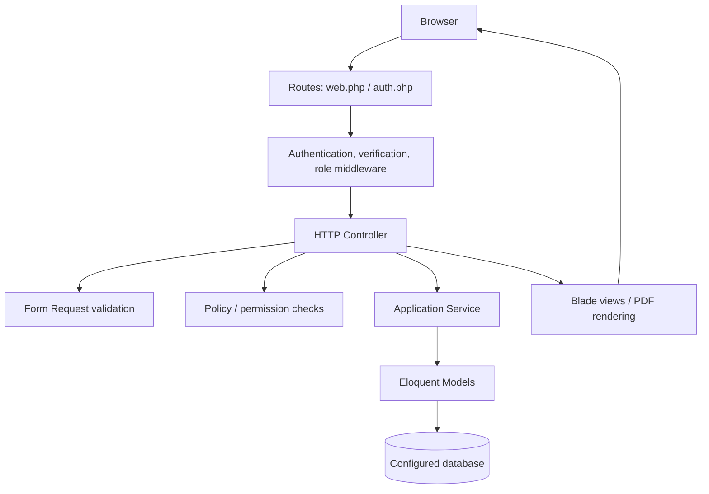

<!-- markdownlint-disable -->

# Architecture Documentation


This document is the canonical architectural map of SIMPEG. It records the repository structure, runtime and test toolchain, request flow, public test seams, and constraints relevant to safe changes.

> [!NOTE]
> **Updated 2026-09-24** after the Izin controller refactor introduced `App\Services\IzinSubmissionService` as a new public test seam. This section numbering is this repository's own; it satisfies the standard architecture-map template by content, not by heading number: Overview (§1-2), Technology Stack (§2), Directory Structure & Module Boundaries (§5-6), Testability Matrix & Seam Catalog (§10), Architectural Memory (§"Architectural Memory & Domain Context"), and Recommendations for TDD Velocity (§"Recommendations for TDD Velocity"). Sections §3, §4, §8, §9, and §11 are repository-specific additions beyond that template.

## 1. Project Overview

> **Updated 2026-10-06:** Monthly PKP now includes direct module authorization, owner/admin lists, exact scoring, effective identity, immutable submissions, assessor and inspector reassignment, approved PDF printing, private signed-document review/replacement, external PDF submission, monthly deadlines, and real PostgreSQL/MySQL race tests. The 10 MiB upload also passes through production Nginx/PHP-FPM, and qpdf 12.2.0 is verified in FPM, Apache, and workspace images.

SIMPEG is a Laravel-based human-resources information system for managing employees (`Pegawai`), leave requests (`Cuti`), permit requests (`Izin`), monthly performance assessments (`PKP`), organizational records, and national holidays. Its key business workflows include role- and permission-controlled access, approval workflows, leave-balance rules, auditability, and official PDF document generation.

The repository is a single Laravel application with Blade-rendered pages and a small Vite-managed frontend asset pipeline. The application follows a conventional Laravel MVC structure with business operations factored into services and authorization expressed through middleware and policies; it is not organized as a strict Clean Architecture or package-level modular monolith.

## 2. High-Level Architecture & Tech Stack

- **Primary Language:** PHP `^8.1` (CI matrix: PHP 8.2, 8.3, and 8.4); JavaScript ES modules for frontend tooling and browser tests.
- **Frameworks/Libraries:** Laravel 10, Blade, Eloquent, Spatie Laravel Permission, Alpine.js, Tailwind CSS, and Laravel Vite Plugin.
- **Architectural Pattern:** Laravel MVC monolith with service classes for selected business workflows; server-rendered Blade UI.
- **Build/Tooling:** Composer, npm, Vite, Docker (Sail, Apache development, and Nginx/PHP-FPM production assets), Laravel Pint, PHPUnit 10, and Playwright.
- **Frontend scripts:** `npm run dev` and `npm run build`; `package.json` does not define JavaScript test, lint, or format scripts.
- **PHP quality commands:** `php artisan test` and `./vendor/bin/pint --test`.

## 3. Data Flow & Layer Dependencies

A typical web request flows through the route and Laravel middleware stack, then to a controller. Form Request classes validate input; policies and role/permission middleware authorize operations. Controllers coordinate Eloquent models and service classes, then return a Blade view, redirect, or generated document. Services may use database transactions and model locking for state transitions.



`CutiApprovalService` and `IzinApprovalService` are representative public seams for approval behavior. They use transactions and require an expected current status before persisting a transition; the `Cuti` flow also coordinates balance updates. This guards application-level state transitions, while SQLite in-memory tests do not by themselves verify production-database locking semantics.

The PKP workflow uses `PkpAuthorization` to call `PkpPolicy` directly because the global super-admin `Gate::before` callback can grant generic Gate checks before a policy runs. Owner and authorized all-record list queries enforce separate `viewOwnList` and `viewAll` predicates, paginate 25 rows, and expose revision references and completeness state. Draft saves, submission, assessor decisions, reassignment, and document operations use transactional services with aggregate versions; attempts snapshot identity, exact scores, and assigned authority. The `/pkp/assessments` queries limit content and document work to the current assigned assessor/inspector.

`PkpErrorResponses` is registered only on the authenticated PKP route group.
It normalizes Laravel-rendered validation/authorization/resource/database
failures into PKP error envelopes and preserves HTML field feedback with
non-file input. Private source downloads include the applicable attempt in
their policy context. PDF inspection bounds stdout and stderr together at
64 KiB per operation, each operation at 5 seconds, and the entire inspection
at 15 seconds. `PdfValidationLimit` maps to 422; unavailable qpdf maps to 503.

Owner draft authoring supports bounded nullable notes and an eligible allowed
assessor selection for both application and external sources. Saves lock the
period/configuration before the aggregate and revalidate current/requested
assignment. PKP edit-decimal fields retain raw whitespace through the global
trim middleware so request validation can reject it; other fields and modules
keep their existing normalization. Stored editor/snapshot decimal values are
projected as invariant strings using Brick decimal normalization without
rounding. Detail exposes policy-derived correction and identity-refresh
capabilities; the correction form uses the existing revision-create endpoint.

PKP detail accepts scoped `revision_uuid` and optional `submission_uuid`
selectors. Official and pending read contexts are authorized independently;
only visible contexts enter the response and navigation. Historical reads use
frozen attempt input/identity/score, disable mutation actions, and expose
first-submission/deadline/classification snapshots. Assessor history is scoped
to current assigned attempts and its own content decisions; historical source
downloads require that same decision/source relationship. The history view
omits private storage paths. `PkpAssessmentService::queuePage()` provides
25-row paginators for both kinds, while `queue()` retains the first-page array
adapter for existing callers. Queue links select the exact revision.

## 4. Dependencies & External Services

- **Database:** Laravel-configured database; PHPUnit defaults to SQLite `:memory:`. README documents MySQL-based local/container modes.
- **Authentication and authorization:** Laravel authentication/verification and Spatie Laravel Permission with project-specific role and permission models.
- **PDF rendering and inspection:** `barryvdh/laravel-dompdf` renders official documents; qpdf 11+ validates uploaded PKP PDFs through an absolute configured executable. Approved current and archived PKP printing uses the bound immutable submission; application PDFs include frozen notes and an exact calculation appendix. `PkpPdfTest` inspects real QDF text with the same qpdf prerequisite, while local Poppler extraction/rendering independently verifies multipage layout. Maximum-length print text uses continuation rows and wrapped notes with actual page-coordinate checks; identity resolution reads employee and both period histories in one SQL statement, proved by controlled committed-worker barriers on both supported engines.
- **HTTP client and monitoring:** Guzzle and Sentry Laravel integration.
- **Backup and revisions:** Spatie Laravel Backup and Venturecraft Revisionable.
- **Queue/cache/session:** Laravel drivers selected by environment; Docker documentation describes Redis-capable development and production configurations. PHPUnit overrides queue, cache, and session to synchronous/in-memory-friendly drivers.
- **Container/deployment:** Compose-based Sail and Apache development modes, plus production Dockerfiles for Nginx and PHP-FPM. README notes production containers can be run manually or through an orchestrator.

## 5. Directory Tree Map

```text
.
├── .agents/                 # Agent skills, instructions, and documentation standards
├── .claude/                 # Mirrored agent configuration
├── .github/workflows/       # PHP, browser, DB-concurrency, and upload-stack CI workflows
├── app/
│   ├── Console/             # Artisan commands and scheduling
│   ├── Exceptions/          # Exception handling
│   ├── Http/
│   │   ├── Controllers/     # Web request handlers, including Auth controllers
│   │   ├── Middleware/      # HTTP middleware
│   │   └── Requests/        # Input validation and authorization requests
│   ├── Models/              # Eloquent models
│   ├── Policies/            # Resource authorization rules
│   ├── Providers/           # Laravel service providers
│   ├── Rules/               # Custom validation rules
│   ├── Services/            # Application/domain workflow services
│   ├── Support/             # Domain-oriented types and helpers
│   ├── Traits/              # Shared model/application traits
│   └── View/                # Blade view components
├── bootstrap/               # Application bootstrap
├── config/                  # Laravel configuration
├── database/
│   ├── factories/           # Model factories
│   ├── migrations/          # Database schema history
│   └── seeders/             # Baseline and test/demo data
├── docker/                  # Development and production image configuration
├── docs/                    # Project documentation, ADRs, audits, and this architecture map
├── e2e/                     # Playwright browser tests
├── plan/                    # TDD implementation plans (per-feature tracer-bullet tickets)
├── public/                  # Public web root and built assets
├── resources/
│   ├── css/                 # Frontend styles
│   ├── js/                  # Frontend entry points
│   └── views/               # Blade templates and components
├── routes/                  # Web, API, auth, console, and channel routes
├── spec/                    # Approved technical specifications and public test seam contracts
├── storage/                 # Runtime logs, cache, and generated files
└── tests/
    ├── Feature/             # HTTP, authorization, workflow, and integration tests
    ├── Integration/Pkp/     # Real PostgreSQL/MySQL races and Nginx/PHP upload envelope
    ├── Support/              # Two-process PKP concurrency harness
    └── Unit/                # Service, policy, rule, middleware, and support tests
```

## 6. Directory Purposes & Responsibilities

| Directory/File | Primary Purpose | Contains | Rules / Constraints |
| --- | --- | --- | --- |
| `app/Http/Controllers/` | Handle HTTP use cases | Resource, workflow, profile, and authentication controllers | Keep HTTP orchestration at the boundary; test observable behavior through Feature tests. |
| `app/Http/Requests/` | Validate and authorize request data | Store/update/verification request classes | Keep request-boundary validation explicit and cover invalid input. |
| `app/Http/Middleware/` | Apply cross-cutting request behavior | Authentication-related and security middleware | Exercise behavior through middleware or HTTP Feature tests. |
| `app/Policies/` | Centralize model/action authorization | `CutiPolicy`, `IzinPolicy`, `PkpPolicy` | Preserve role, permission, assignment, ownership, and status constraints; PKP uses its direct `PkpAuthorization` boundary rather than generic Gate results. |
| `app/Services/` | Encapsulate application workflows and reusable operations | Approval, balance, eligibility, workday, query, approver, document, submission, assignment, identity, calculation, assessment, deadline, and PDF services | Public service methods are unit/feature test seams; state transitions preserve transactions, aggregate versions, and current-state guards. |
| `app/Models/` | Represent persisted business records | `Pegawai`, `Cuti`, `Izin`, `User`, and related records | Relationships and persistence behavior are backed by migrations and factories. |
| `app/Support/` and `app/Rules/` | Hold domain-oriented value helpers and validation rules | Cuti/Izin types and `SafeEmail` | Prefer focused unit tests for deterministic behavior. |
| `database/` | Define and populate persistence | Migrations, factories, seeders | Schema changes require migration safety and relevant persistence tests. |
| `routes/` | Declare HTTP and console entry points | `web.php`, `auth.php`, `api.php`, `console.php`, `channels.php` | Middleware and route ordering are behaviorally significant; cover access via Feature tests. |
| `resources/views/` | Render server-side user interface | Blade pages, layouts, components, and PDF templates | User-visible flows can be verified through HTTP assertions and Playwright. |
| `tests/Unit/` | Test focused units and policy boundaries | 19 PHP test files | PHPUnit Unit suite configured in `phpunit.xml`; currently many tests use Laravel/database support, while structural pins inspect source directly. |
| `tests/Feature/` | Verify integrated application behavior | 32 PHP test files | Covers route, auth, RBAC, workflow, middleware, and document authorization seams. |
| `spec/` | Hold approved technical specifications | `spec-feature-*.md` with requirements, acceptance criteria, and pre-agreed test seam contracts | Approved specs are the frozen execution baseline; do not modify them from the code phase. |
| `plan/` | Hold TDD implementation plans | `plan-*-refactor.md`, `plan-feature-*.md` with tracer-bullet tickets | Each ticket declares RED/GREEN/VERIFY/COMMIT steps against a named seam; keep plans in step with what was actually executed. |
| `docs/adr/` and `docs/audit/` | Record architectural decisions and quality-gate audits | Numbered ADRs and clarification/consistency audit reports | Create an ADR only when the decision passes the three-gate test; never overwrite an existing audit report. |
| `e2e/` | Verify browser-visible behavior | Playwright specs | Keep end-to-end checks on observable user outcomes; CI currently runs Chromium only. |
| `.github/workflows/` | Run CI quality gates | PHP tests/build and Playwright workflows | Workflow behavior is authoritative where it differs from README or quality policy. |
| `docker/` | Package runtime variants | Apache, PHP-FPM, Nginx, and development images | Environment and runtime topology are described in README and deployment docs. |

## 7. Key Configuration Files

- `composer.json`: PHP runtime constraints, Laravel dependencies, PSR-4 autoloading, and Composer lifecycle scripts.
- `package.json`: Vite build/dev commands and frontend/browser-test dependencies; no standalone JS test/lint scripts are declared.
- `phpunit.xml`: Unit/Feature suites, `app/` source inclusion, and SQLite in-memory testing defaults.
- `phpunit.pkp-concurrency.xml`: Isolated real-engine integration suite; it deliberately does not force SQLite or wrap fixtures in a parent transaction.
- `compose.pkp-tests.yaml`: Disposable PostgreSQL 16/MySQL 8 databases plus an Nginx/PHP-FPM stack for PKP upload-envelope checks.
- `playwright.config.js`: E2E directory, browser projects (Chromium, Firefox, WebKit), web server command, and CI reporter/retry settings.
- `playwright.pkp.config.js`: PKP-only Chromium harness with a dedicated persistent SQLite fixture database and guarded test-fixture seeder; its twelve browser scenarios cover owner list/create/edit, admin all-record/deadline pages, assessment queues, printing, upload/review, external-source submission, correction approval, historical decision navigation, and R1 inspection while R2 is pending.
- `vite.config.js`: Laravel Vite plugin and CSS/JavaScript entry points.
- `routes/web.php` and `routes/auth.php`: Primary web and authentication route definitions.
- `.github/workflows/php-tests.yml`: PHP 8.2–8.4 matrix, frontend build, Pint, PHPUnit, and Composer audit step.
- `.github/workflows/playwright.yml`: Chromium E2E setup and execution in CI.
- `.github/workflows/pkp-integration.yml`: Separate PostgreSQL/MySQL race gates and the production Nginx/PHP-FPM upload test stack.
- `CONSTITUTION.md` and `CONSTRAINTS.md`: Project engineering principles and required quality gates.

## 8. Entry Points

- **Application initialization:** `public/index.php` loads the Laravel application through `bootstrap/app.php`; `artisan` is the CLI entry point.
- **HTTP routing:** `routes/web.php`, with authentication routes loaded from `routes/auth.php`; API routes are declared in `routes/api.php`.
- **Authentication:** Laravel authentication controllers under `app/Http/Controllers/Auth/`.
- **Frontend assets:** `resources/js/app.js` and `resources/css/app.css`, built by Vite.
- **Scheduled/console behavior:** `routes/console.php` and `app/Console/Kernel.php`.

## 9. Environment & Deployment

- **CI/CD:** GitHub Actions workflows in `.github/workflows/` run on pushes and pull requests to `main`/`master`.
- **PHP workflow:** Tests PHP 8.2, 8.3, and 8.4; installs Composer/npm dependencies; builds assets; runs Pint and PHPUnit. Its `composer audit` command ends with `|| true`, so audit findings do not currently fail this job.
- **Browser workflow:** Installs and runs Playwright Chromium tests; uploads the HTML report artifact.
- **Deployment:** Docker development configurations include Sail and Apache; production Dockerfiles separate Nginx and PHP-FPM. The README states production can be launched manually or with an orchestrator.
- **Critical environment variables:** `APP_ENV`, `APP_DEBUG`, `APP_KEY`, `DB_HOST`, `DB_DATABASE`, `DB_USERNAME`, `DB_PASSWORD`, and environment-dependent `CACHE_DRIVER`, `QUEUE_CONNECTION`, and `SESSION_DRIVER`. Production secrets must be supplied through the deployment environment.

## 10. Testing Strategy

- **PHP framework:** PHPUnit 10 through Laravel; configured suites are `Unit` and `Feature`.
- **PHP test locations:** `tests/Unit/`, `tests/Feature/`, and `tests/Integration/Pkp/` cover PKP authorization, owner/admin list scopes, exact calculation, lifecycle, reassignment, replacement, history retention, runtime PDF validation, and upload envelopes. `PkpWorkflowRaceTest` uses committed fixtures and two independent PHP workers. A further three files at the `tests/` root provide ordinary suite support.
- **Browser framework:** Playwright; the dedicated PKP harness runs twelve Chromium flows against an isolated persistent test database, including desktop/mobile lists, reassignment, final replacement, metadata/correction, history navigation, dual-context inspection, printing, and external-source approval.
- **Database:** Ordinary PHPUnit uses SQLite `:memory:` for fast isolated cases. The separate concurrency suite has passed on PostgreSQL 16 and MySQL 8.4 using independent connections/processes; this supplies real row-lock evidence for the covered transitions.
- **Shared setup:** `tests/SimpegTestCase.php` clears cached permissions, seeds permission definitions, and provides a role/user/pegawai factory helper.
- **Commands:**
  - `php artisan test`
  - `php artisan test --filter=CutiPolicyTest`
  - `./vendor/bin/pint --test`
  - `npx playwright test --project=chromium`
  - `npm run build`
- **Public test seams and current assessment:**

| Module / Layer | Primary Test Seam | Test Type | Observed Strategy | Testability Score |
| --- | --- | --- | --- | --- |
| Services and workflow rules | Public service methods such as `CutiApprovalService::applyPimpinan()` | Unit / Feature | Laravel app and SQLite database; asserts resulting status and balance | 4/5 |
| PKP authorization | `PkpAuthorization::allows()` and direct `PkpPolicy` predicates | Unit / Feature | Real Spatie provider verifies unlinked admin configuration and denial despite a positive global super-admin Gate result | 5/5 |
| PKP scoring and identity | `PkpCalculator::calculate()` and `PkpIdentityService::resolve()` | Unit | Independent rational oracles, month-end history selection, tie-conflict rejection, and source history UUID retention | 5/5 |
| PKP list and lifecycle | `PkpSubmissionService::list/create/save/submit()` and `PkpAssessmentService::decide/queue()` | Feature / E2E | Real SQLite migrations, owner/admin scope and pagination, HTTP assignment checks, frozen attempt hashes, approval/return, private document review, deadlines, and browser entry | 5/5 |
| PKP database concurrency | `PkpConcurrencyHarness::runTogether()` and `PkpWorkflowRaceTest` | Integration | Two independently booted PHP workers race duplicate create/revise/decisions, deadline/submit, and assessor assignment/approval on PostgreSQL 16 and MySQL 8.4 | 5/5 |
| PKP upload envelope | `PkpUploadEnvelopeTest` through production Nginx/PHP-FPM | Integration / Runtime | Real authenticated session and CSRF; 10 MiB accepted, 10 MiB + 1 byte rejected by Laravel, and requests above 16 MiB rejected by Nginx with prior binding retained | 5/5 |
| PKP private upload recovery | `PkpDocumentService::store/download` and revision-bound metadata | Feature / Runtime | Injected metadata failure removes staged B while accepted A, its review, and authorized private download remain intact | 5/5 |
| Izin submission rules | `IzinSubmissionService::prepareForCreate()`, `prepareForFullUpdate()`, and `resolveOwnerUuid()` | Unit | Pure domain rules against real `WorkdayService`/`IzinType` and SQLite; mocking these dependencies is prohibited, and `Carbon::setTestNow()` supplies date determinism | 5/5 |
| Structural refactor invariants | Source inspection via `ReflectionMethod::getFileName()`/`getStartLine()`, e.g. `tests/Unit/IzinStructureTest.php` | Unit | Asserts that relocated rules live in the trait and that the controller holds no PERMA rule logic; tolerant of reformatting because it reads declarations, not text matches | 4/5 |
| Policies and middleware | Policy methods and HTTP routes guarded by middleware | Unit / Feature | Direct policy assertions plus authenticated HTTP requests | 4/5 |
| Controllers and routes | Named Laravel routes and HTTP response | Feature | Framework request lifecycle with refreshed database and role fixtures | 4/5 |
| Persistence and transaction behavior | Eloquent models and migration-backed operations | Feature | SQLite in-memory; not equivalent to production-engine concurrency tests | 3/5 |
| Browser-visible workflows | URLs, labels, buttons, and page state | Playwright E2E | Real Laravel web server; current suite covers guest login/redirect only | 2/5 |
| Document generation | Document service public methods and authorization route | Unit / Feature | Service-level coverage exists for Cuti document behavior; authorization is separately tested | 3/5 |

Scores are a qualitative snapshot of the inspected test seams and existing coverage, not a code-coverage measurement.

## 11. AI Agent Boundaries

- Follow `AGENTS.md`, `CONSTITUTION.md`, and `CONSTRAINTS.md`; use Indonesian for user-facing communication and English for code and generated documentation.
- Treat approved specifications and plans as the source of truth for feature work; use test-first Red-Green-Refactor at agreed public seams.
- Do not weaken or skip tests, remove assertions, or add suppressions to bypass quality gates.
- For behavior changes, add focused PHPUnit coverage and run the relevant full test and quality checks; run affected Playwright flows when user-facing browser behavior changes.
- Preserve RBAC, ownership/assignment checks, approval order, leave-balance correctness, auditability, and database safety.
- Update this architecture map when code changes introduce architectural modules, directories, or public test seams.

## Architectural Memory & Domain Context

- **Domain terminology:** A root [`CONTEXT.md`](../CONTEXT.md) now holds the canonical glossary — 11 terms so far (Izin, Jenis Izin, Jenis Single-Level, Jenis Dua-Level, Hari Kerja, Nomor Surat Izin, Pegawai, Atasan Pimpinan, Pimpinan, No-Surat Update, Full Update) — each with rejected synonyms under `_Avoid_`. No `CONTEXT-MAP.md` exists, so the project uses a single root glossary. `AGENTS.md` and `CONSTITUTION.md` additionally treat `Pegawai`, `Cuti`, `Izin`, `atasan`, and `pimpinan` as canonical terms.
- **Key ADRs:** [`docs/adr/0001-izin-no-surat-update-discrimination.md`](./adr/0001-izin-no-surat-update-discrimination.md) records why the Izin No-Surat Update is discriminated by payload shape rather than by a dedicated route or an explicit marker field.
- **Quality-gate audits:** [`docs/audit/`](./audit/) holds the clarification and consistency audit reports that gate each SDLC phase. Audit reports are append-only records of a point-in-time assessment; never overwrite an existing one.
- **Architectural decisions:** This map describes observed implementation. Design intent is recorded in an ADR only when the decision passes the three-gate test — hard to reverse, surprising without context, and a real trade-off. Decisions that fail the gate stay as prose in the relevant specification instead.

## Recommendations for TDD Velocity

- Add Playwright scenarios for authenticated submission and approval paths so critical user-facing behavior is covered beyond guest access.
- Where row-locking and concurrent approvals are a production risk, validate the behavior against the production database engine in an appropriate integration environment; SQLite in-memory tests alone cannot establish it.
- Align the `composer audit` CI behavior with the hard quality constraint that requires dependency audit failures to be actionable; the current PHP workflow intentionally ignores the command's exit status.
- Keep the named route, policy, and service boundaries as agreed public test seams, and add focused regression tests whenever their observable behavior changes.
- For behaviour-preserving refactors, reuse the reflection-based structural pin pattern in `tests/Unit/IzinStructureTest.php`. `ReflectionMethod::getFileName()` reports the trait's file for inherited methods and the class's file for local ones, so the assertion survives reformatting and supplies a genuine failing state for work that changes no behaviour. A plain text grep over a whole file cannot scope the check to one action.
- Treat a new service or controller seam as a change to this document: update the `app/Services/` inventory in §6 and the seam matrix in §10 in the same change, not only the specification. Every SDLC artifact that declares a seam is a reader of this map.
