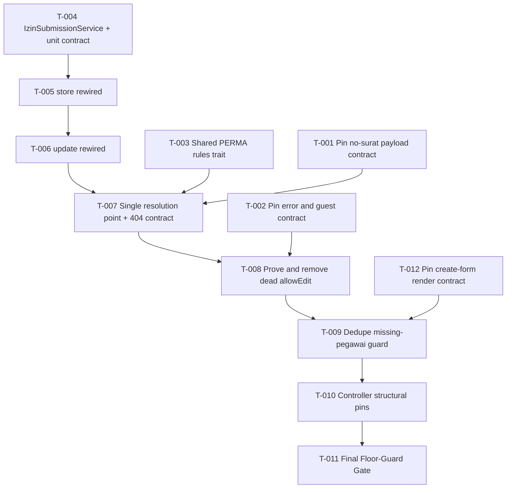

# Implementation Plan: Izin Controller Refactor (Behavior-Preserving)

> [!NOTE]
> **Revised to v1.1 on 2026-09-24** in response to `docs/audit/consistency-audit-izin-controller-refactor-2026-09-24.md`. Changes: **Ticket-012** was added to Phase 1 to pin the create-form render contract (closing the plan side of **MC-1**); Ticket-003 step 0 now confirms the trait path fixed by spec decision **D-004** instead of resolving it; the `formData()` key contract and the scalar `jenisIzin` override are named in the Ticket-005, Ticket-009, and Ticket-011 guardrails; and traceability was refreshed from 41 to **45** acceptance criteria. Ticket numbering is append-only so that prior commits and audits remain valid references.
>
> **Revised to v1.2 on 2026-09-24** in response to `docs/audit/consistency-audit-izin-controller-refactor-phase3-2026-09-24.md`. Changes: a new **§4.0 Execution Progress Ledger** records the real status and commit of every ticket; **Ticket-005 step 1** and **Ticket-006 step 1** were corrected so the structural assertions match what can actually go green in each ticket (closing **MC-5**); **RBCK-001** records the single exception to one-commit-per-ticket (closing **MC-4**); and both the **§6 Floor-Guard** and a new **Ticket-011 step 8** now gate `docs/ARCHITECTURE.md` (closing **MC-6**).

## 1. Architectural Strategy & Task Graph

This plan executes a **strictly behaviour-preserving refactor**: no route, schema, response, flash, validation message, or rendered markup may change. All 41 acceptance criteria in the upstream specification describe **existing behaviour that must not move**, not new capability.

Because a refactor has no new user-observable capability to demo, the tracer-bullet definition is adapted here:

> **One independently reviewable, releasable change where the entire existing suite stays green and exactly one structural goal is met.**

The blast radius spans one controller, two form requests, and one new service, so the work is sequenced with the **Expand → Migrate → Contract** pattern rather than by layer:

| Phase | Pattern | Intent |
| --- | --- | --- |
| 1 | Expand | Add the contract pins that do not exist yet, touching **zero** production files |
| 2 | Migrate | Relocate the duplicated PERMA validation rules into one trait |
| 3 | Migrate | Introduce the `IzinSubmissionService` domain seam and delegate both write paths to it |
| 4 | Migrate | Collapse the update request to a single Izin resolution point while preserving 404 semantics |
| 5 | Contract | Remove the duplicated authorization decision, deduplicate the guard, lock the final shape, and close the floor-guard gate |

Bottom-up ordering is enforced: the domain rules and the service exist before any controller action consumes them.

`T-005 → T-006 → T-007 → T-008 → T-009` are strictly sequential because every one of them edits `app/Http/Controllers/IzinController.php`. Running them concurrently would produce conflicting edits to the same file.

`T-012` must land **before** `T-009`: it pins the render contract of the three create actions, and `T-009` is the ticket that edits all three of them. That ordering is what makes the guard deduplication safe rather than hopeful.

## 2. Requirements & Constraints

### 2.1 Functional Requirements (from Spec §3.1)

- **REQ-001**: PERMA submission normalization has exactly one implementation, exposed from `IzinSubmissionService`. → T-004
- **REQ-002**: `store()` delegates all normalization and contains no jenis-specific branching. → T-005
- **REQ-003**: `update()` delegates all normalization and contains no jenis-specific branching. → T-006
- **REQ-004**: `IzinPolicy::update()` is the sole edit authority; `edit()` recomputes nothing. → T-008
- **REQ-005**: The Izin is resolved once per request and reused by `authorize()`, `rules()`, and the action. → T-007
- **REQ-006**: Full-update document lifecycle is preserved (store, rebind, delete superseded, cleanup on failure). → T-006
- **REQ-007**: `IzinSubmissionService` is HTTP-agnostic; the acting `User` is passed explicitly. → T-004
- **REQ-008**: `resolveOwnerUuid()` is invoked before `prepareForCreate()`. → T-005
- **REQ-009**: Upload orchestration stays in the controller with `IzinDocumentService`. → T-005, T-006
- **REQ-010**: The explicit `uuid` assignment in `store()` is preserved. → T-005
- **REQ-011**: The identical `jenis()`, `jenisRules()`, `messages()` move into one shared trait; `rules()` stays per class. → T-003
- **REQ-012**: Unknown `{izin}` yields 404 before any policy evaluation; only an existing unauthorized Izin yields 403. → T-007
- **REQ-013**: A No-Surat Update is a payload of at most three entries (`_token`, `_method`, `no_surat_izin`). → T-001

### 2.2 Security Requirements (from Spec §3.2)

- **SEC-001**: Every attribute written to `Izin` originates from `validated()` or the service, and stays within `Izin::$fillable`. → T-005, T-006
- **SEC-002**: Authorization is not weakened; `IzinPolicy` remains the only authority. → T-008
- **SEC-003**: Only `super-admin`/`admin` may attribute an Izin to another Pegawai. → T-004, T-005
- **SEC-004**: Storage paths stay inside `IzinDocumentService`. → T-006
- **SEC-005**: The 404-before-policy ordering must not regress. → T-007

### 2.3 Constraints (from Spec §3.3 and `CONSTRAINTS.md`)

- **CON-001**: PHP `^8.1`, Laravel `^10.10`; no new Composer or npm dependency.
- **CON-002**: `php artisan test` 100% pass; `./vendor/bin/pint --test` 0 errors on changed files.
- **CON-003**: No suppression annotations, no skipped tests, no weakened assertions, no lowered thresholds.
- **CON-004**: No migration and no schema change.
- **CON-005**: `npx playwright test --project=chromium` must not regress.
- **CON-006**: No file matching an **existing** `tests/**/*Izin*` path may be modified or deleted.

### 2.4 Traceability Summary (refreshed for v1.1)

- **Acceptance criteria mapped: 45 of 45.** The upstream specification now carries AC-001 through AC-045 after the consistency-audit remediation added the create-form render contract.
- **Requirements mapped:** REQ-001–REQ-013, SEC-001–SEC-005, and CON-001–CON-006 each map to at least one ticket.
- **Added in v1.1:** AC-042, AC-043, AC-044, and AC-045 map to the new Ticket-012. The 41 criteria already mapped in v1.0 keep their existing ticket assignments; the eight criteria that guard code paths this refactor does not modify (AC-017, AC-018, AC-025, AC-026, AC-027, AC-028, AC-029, AC-030) remain pinned by the inherited characterization suite and are verified explicitly in Ticket-011 steps 7 and 10.

## 3. Risks & Assumptions (Extracted from Spec)

| ID | Assumption / Risk | Risk | Handled in |
| --- | --- | --- | --- |
| ASSUMPTION-001 | PRD phase bypassed; the brief is `discovery-draft.md` + `docs/refactor/legacy-plan-application.md` + the green characterization suite. | Low | Plan baseline |
| ASSUMPTION-002 | `$allowEdit` in `edit()` is unreachable because `IzinPolicy::update()` already implies it. **Unproven until the equivalence matrix exists.** | **High** | T-008, step 1 |
| ASSUMPTION-003 | ~~The shared trait's class name and namespace are unresolved.~~ **Resolved by spec decision D-004:** the trait is fixed at `app/Traits/JenisIzinRulesTrait.php` with `namespace App\Traits;`, derived from the repository's only trait precedent (`app/Traits/UserTrackingTrait.php`). Ticket-003 step 0 now confirms the path rather than resolving it. | Medium | T-003, step 0 |
| ASSUMPTION-004 | The explicit `Str::uuid()` override in `store()` must be preserved because `Izin` uses `HasUuids` (ordered UUIDs). | Medium | T-002, T-005 |
| ASSUMPTION-005 | The `count($this->all()) <= 3` threshold equals `_token` + `_method` + `no_surat_izin` and must be retained and pinned at both ends. | Medium | T-001 |
| ASSUMPTION-006 | The `DB::listen()` query-count technique is new to this repository and may need iteration on the statement filter. | Medium | T-007, step 1 |
| ASSUMPTION-007 | ~~The upstream spec is still `Draft`, not `Approved`.~~ **Resolved on 2026-09-24:** `spec/spec-feature-izin-controller-refactor.md` was raised to `Approved` (v1.1) at the user's instruction, so this plan executes against a frozen, approved baseline. | Closed | Resolved 2026-09-24 |
| ASSUMPTION-008 | The `abort(500)` delete guard (A4) and the `?? $izin->uuid` fallback (A6) are unreachable but deliberately retained. | Low | T-010 |
| ASSUMPTION-009 | Collapsing the duplicated `countWorkdays()` call in `store()` is value-identical in all cases. | Low | T-004 |
| ASSUMPTION-010 | Decisions D-001, D-002, and D-003 are closed and recorded; no further requirement discovery is expected. | Low | Plan baseline |
| ASSUMPTION-011 | The create-form render contract (AC-042–AC-045) was pinned by no test before this revision, yet Ticket-009 edits all three of its actions. **Ticket-012 must land before Ticket-009**, otherwise the guard deduplication runs unprotected. | Medium | T-012 |
| ASSUMPTION-012 | Two prior repository decisions are deliberately reversed: KC-1 deferred the trait extraction (`docs/superpowers/reports/task-2-review.md:55`) and KC-2 accepted an extra lookup (`docs/superpowers/reports/final-fix-implementer.md:26`). Spec §9 records both reversals; only the resulting behaviour is test-pinned, not the intent. | Low | Spec §9 |

## 4. Tracer-Bullet Implementation Slices

### 4.0 Execution Progress Ledger (authoritative)

This ledger is the authoritative record of execution state. The per-step checkboxes under each ticket below remain the approved plan of record and are **not** maintained as live state — read this table for what is actually done.

| Ticket | Status | Commit |
| --- | --- | --- |
| T-001 Pin no-surat payload contract | ✅ Complete | `2cacfaa` |
| T-002 Pin error and guest contract | ✅ Complete | `ace1ff5` |
| T-012 Pin create-form render contract | ✅ Complete | `1e6e2f0` |
| T-003 Shared PERMA rules trait | ✅ Complete | `8fea342` |
| T-004 IzinSubmissionService + unit contract | ✅ Complete | `ce393d4` |
| T-005 store rewired | ✅ Complete | `aec21ec` |
| T-006 update rewired | ✅ Complete | `aec21ec` (shared with T-005; see RBCK-001) |
| T-007 Single resolution point + 404 contract | ✅ Complete | `2283f2d` |
| T-008 Prove and remove dead `$allowEdit` | ✅ Complete | uncommitted |
| T-009 Dedupe missing-pegawai guard | ✅ Complete | uncommitted |
| T-010 Controller structural pins | ✅ Complete | uncommitted |
| T-011 Final Floor-Guard Gate | ✅ Executed, awaiting sign-off | — |

All twelve tickets have been executed. Phases 1 through 4 were approved at their gates. Suite state at the end of Phase 5: **353 passed, 822 assertions**. The AC-002 structural gate is complete: the controller holds zero occurrences of `WorkdayService`, `isSingleLevel`, `maxWorkdays`, and `$allowEdit`, exactly one missing-pegawai guard, and the two deliberately retained branches.

Two gate results to read carefully:

- **AC-033 (Playwright) is UNVERIFIED, not passed.** `node_modules/` is absent in this environment, so the Chromium suite could not run. The structural reason to expect no regression is that no Blade view, route, or frontend asset changed (`git diff --stat resources/ routes/` is empty), but that is an argument, not a test result.
- **AC-001 holds for the inherited oracle only.** `git diff --stat 27c1467 -- tests/` shows that since the characterization commit, only three refactor-owned files changed — `IzinNoSuratBoundaryTest`, `IzinStructureTest`, and `IzinSubmissionServiceTest` — and **no inherited characterization file was touched**. The plan's Ticket-005, 006, 008, 009, and 010 all instruct extending `IzinStructureTest`, so audit finding MC-7 asks the specification to distinguish "inherited oracle file" from "refactor-owned file" explicitly.

Committed outside the ticket sequence to establish a clean AC-001 baseline: `27c1467` records the Izin characterization suite plus the `phpunit.xml` hardening, which had been sitting as uncommitted work. Without that commit, AC-001's verification command (`git status --short tests/`) produced a false positive because `IzinDocumentAuthorizationTest.php` showed as modified. Documentation remediation for audit iteration 2 is recorded in `0603dc6`.

### Phase 1: Safety-Net Expansion (zero production change)

#### Ticket-001: Pin the No-Surat Update payload contract

- **Target Seam:** `POST izin/{izin}` and `PUT izin/{izin}` via `tests/Feature/IzinNoSuratBoundaryTest.php`
- **Upstream Ref:** Spec §4.2, §5.4, §5.8 | REQ-013 | AC-017, AC-018, AC-019, AC-020, AC-034
- **Oracle note:** AC-017 and AC-018 are already pinned by the existing `IzinLifecycleTest`. They are named here because this ticket owns the no-surat contract surface; they must remain green without modification.
- **File Impact:** `tests/Feature/IzinNoSuratBoundaryTest.php` (new) (Size S)
- [ ] **Step 1 (RED):** Create the file with three tests. **AC-034:** atasan-approved Izin + `POST` carrying `_method=PUT`, `_token`, and `no_surat_izin` → redirects to `izin.index` with the `success` flash `Nomor surat izin berhasil diperbarui` and only `no_surat_izin` changes. **AC-019:** atasan-approved Izin + `no_surat_izin` plus three additional keys → not a No-Surat Update. **AC-020:** Izin with `verifikasi_atasan` = `Belum Diverifikasi` + only `no_surat_izin` → not a No-Surat Update (no no-surat success flash; the full-update validation path is taken and the stored `no_surat_izin` stays null). These pin current behaviour, so they pass immediately — record that explicitly in the commit body.
- [ ] **Step 1b (RED proof, mandatory):** Temporarily change `count($this->all()) <= 3` to `<= 1` in `UpdateIzinRequest::isNoSuratUpdate()`, run the AC-034 test, and confirm it **FAILS**. Restore the line exactly. If it does not fail, the pin is vacuous and must be rewritten. `git diff app/` must be empty after this step.
- [ ] **Step 2 (GREEN):** No production change is required for this ticket.
- [ ] **Step 3 (VERIFY):** Run `php artisan test --filter=IzinNoSuratBoundaryTest`, `./vendor/bin/pint --test tests/Feature/IzinNoSuratBoundaryTest.php`, and `git diff --stat app/` (must be empty).
- [ ] **Step 4 (COMMIT):** `test(izin): pin the no-surat update payload contract at both ends`

#### Ticket-002: Pin the update error contract and guest behaviour

- **Target Seam:** `PUT izin/{izin}`, `POST izin`, and `GET` login redirect via `tests/Feature/IzinContractPinTest.php`
- **Upstream Ref:** Spec §5.8 | REQ-012, SEC-005 | AC-035, AC-036, AC-037, AC-039
- **File Impact:** `tests/Feature/IzinContractPinTest.php` (new) (Size S)
- [ ] **Step 1 (RED):** Create the file with four tests. **AC-035:** `PUT izin/{random-uuid}` as an authenticated non-admin → 404, and as an admin → 404. **AC-036:** `PUT izin/{existing-uuid}` as a non-owner non-admin → 403. **AC-037:** guest `POST izin` and guest `PUT izin/{izin}` both redirect to `login`. **AC-039:** a successful `store` persists a `uuid` matching the UUID v4 pattern.
- [ ] **Step 1b (RED proof, mandatory):** Temporarily rewrite `UpdateIzinRequest::authorize()` so a null resolution returns `false` instead of throwing — this is the exact regression C1 describes. Confirm the AC-035 test **FAILS** with 403, then restore the original `firstOrFail()` body exactly. `git diff app/` must be empty after this step.
- [ ] **Step 2 (GREEN):** No production change is required for this ticket.
- [ ] **Step 3 (VERIFY):** Run `php artisan test --filter=IzinContractPinTest`, `./vendor/bin/pint --test tests/Feature/IzinContractPinTest.php`, and `git diff --stat app/` (must be empty).
- [ ] **Step 4 (COMMIT):** `test(izin): pin the update error contract and guest behaviour`

#### Ticket-012: Pin the create-form render contract

- **Target Seam:** `GET izin/create`, `GET izin/keluar-kantor/create`, `GET izin/tidak-masuk/create` via `tests/Feature/IzinCreateFormTest.php`
- **Upstream Ref:** Spec §4.3.1, §5.9 | REQ-011 (guard deduplication) | AC-042, AC-043, AC-044, AC-045
- **File Impact:** `tests/Feature/IzinCreateFormTest.php` (new) (Size S)
- **Why this ticket exists:** the consistency audit (finding MC-1) found **zero** test coverage for the three create routes, even though Ticket-009 edits all three actions that produce them. This is a safety-net ticket and **must land before Ticket-009**.
- **Guardrails (do not break):** `formData()` keys and types are fixed by Spec §4.3.1 — `pegawai`, `jenisIzin`, `pimpinanList`, `atasanList`. `jenisIzin` is a list on every path **except** `createKeluarKantor()`, where it is deliberately the scalar `IzinType::KELUAR_KANTOR`.
- [ ] **Step 1 (RED):** Create `tests/Feature/IzinCreateFormTest.php` with four tests. **AC-042:** `GET izin/create` → 200, view `izin.create`, view data exposes `pegawai`, `jenisIzin` containing every value of `IzinType::all()`, `pimpinanList`, and `atasanList`. **AC-043:** `GET izin/keluar-kantor/create` → 200, view `izin.create-keluar-kantor`, and `jenisIzin` strictly equals the scalar `IzinType::KELUAR_KANTOR`. **AC-044:** `GET izin/tidak-masuk/create` → 200, view `izin.create-tidak-masuk`, `jenisIzin` containing every value of `IzinType::all()`. **AC-045:** a user permitted to create but with **no linked Pegawai** → all three routes redirect to `izin.index` with the `error` flash `Data pegawai tidak ditemukan`; construct that user directly with `User::factory()` plus a role assignment, because the shared test helper always creates a Pegawai. These pin current behaviour, so they pass immediately — record that explicitly in the commit body.
- [ ] **Step 1b (RED proof, mandatory):** Temporarily change the `createKeluarKantor()` override to `$data['jenisIzin'] = IzinType::all();` and confirm the AC-043 test **FAILS**. Restore the line exactly. Separately, temporarily alter one of the three guard messages and confirm AC-045 fails. `git diff app/` must be empty afterwards.
- [ ] **Step 2 (GREEN):** No production change is required for this ticket.
- [ ] **Step 3 (VERIFY):** Run `php artisan test --filter=IzinCreateFormTest`, `./vendor/bin/pint --test tests/Feature/IzinCreateFormTest.php`, and `git diff --stat app/` (must be empty).
- [ ] **Step 4 (COMMIT):** `test(izin): pin the create-form render contract`

- [ ] **VERIFY PHASE 1:** Run the complete suite `php artisan test` — expect no failures and no change to the pre-existing Izin test files.
- [ ] **APPROVAL PHASE 1:** 🛑 Stop and wait for user confirmation.

---

### Phase 2: Shared PERMA Rules (Migrate)

#### Ticket-003: Extract the shared PERMA rule trait

- **Target Seam:** The trait consumed by `StoreIzinRequest` and `UpdateIzinRequest`; behaviour observed at the HTTP validation seam
- **Upstream Ref:** Spec §4.3, §6.4, §7 | REQ-011 | AC-041
- **File Impact:** `app/Traits/JenisIzinRulesTrait.php` (new), `app/Http/Requests/StoreIzinRequest.php`, `app/Http/Requests/UpdateIzinRequest.php`, `tests/Unit/IzinStructureTest.php` (new) (Size M)
- [ ] **Step 0 (PRE-FLIGHT, confirmation only):** The path and name are **fixed by spec decision D-004**: `app/Traits/JenisIzinRulesTrait.php`, `namespace App\Traits;`, `trait JenisIzinRulesTrait`. Confirm that `app/Traits/UserTrackingTrait.php` still establishes that convention (`namespace App\Traits;`, `XxxTrait` suffix) and proceed. Do **not** introduce an `App\Http\Requests\Concerns` namespace.
- [ ] **Step 1 (RED):** Create `tests/Unit/IzinStructureTest.php` with the AC-041 assertions: the file `app/Traits/JenisIzinRulesTrait.php` exists and declares `trait JenisIzinRulesTrait` in `namespace App\Traits;`; both request classes `use` it; neither declares a local `jenis()`, `jenisRules()`, or `messages()`. Run → RED.
- [ ] **Step 2 (GREEN):** Create the trait holding `jenis()` (`StoreIzinRequest.php:86-91`), `jenisRules()` (`61-84`), and `messages()` (`34-53`) moved **verbatim**. Delete the local copies from both classes and add the `use` statement. Do not alter a single rule, error key, or message string.
- [ ] **Step 3 (VERIFY):** Run `php artisan test --filter=IzinStructureTest`, then `php artisan test --filter='IzinPermaValidationTest|IzinValidationRulesTest'` (the 23 verbatim PERMA pins), then full `php artisan test`, then `./vendor/bin/pint --test`.
- [ ] **Step 4 (COMMIT):** `refactor(izin): extract shared PERMA request rules into a trait`
- **Note:** No dedicated unit test for the trait — Spec §6.4 forbids it as tautological under `CONSTRAINTS.md §3.4`.

- [ ] **VERIFY PHASE 2:** Run `php artisan test` and confirm the 23 PERMA assertions are unchanged in count.
- [ ] **APPROVAL PHASE 2:** 🛑 Stop and wait for user confirmation.

---

### Phase 3: Submission Domain Seam (Migrate)

#### Ticket-004: Create `IzinSubmissionService` with contract unit tests

- **Target Seam:** `IzinSubmissionService::prepareForCreate()`, `prepareForFullUpdate()`, `resolveOwnerUuid()`
- **Upstream Ref:** Spec §4.1, §4.1.1, §4.1.2, §4.1.3 | REQ-001, REQ-007 | AC-003, AC-004, AC-005, AC-006, AC-007, AC-008
- **File Impact:** `app/Services/IzinSubmissionService.php` (new), `tests/Unit/Services/IzinSubmissionServiceTest.php` (new) (Size S)
- [ ] **Step 1 (RED):** Write unit tests covering AC-005 (Jenis Single-Level with distinct dates → `jumlah_hari` 0 and both dates equal `now()->toDateString()`, using `Carbon::setTestNow()`), AC-006 and AC-007 (tidak-masuk over the two-Hari-Kerja cap → `ValidationException` with key `tanggal_selesai` and the exact message `Izin tidak masuk kerja maksimal 2 (dua) hari kerja.`), AC-008 (the full five-row attribution table including `null` and `''`), AC-004 (no HTTP request is issued), and REQ-010 pass-through (unknown keys survive untouched; `prepareForFullUpdate()` neither emits nor alters `status`, `verifikasi_atasan`, `verifikasi_pimpinan`, or `no_surat_izin`). Run → RED.
- [ ] **Step 2 (GREEN):** Implement the class as a **non-`final`** class with exactly the three public methods. Real `WorkdayService` and `IzinType`; no mocks permitted.
- [ ] **Step 3 (VERIFY):** Run `php artisan test --filter=IzinSubmissionServiceTest` and `./vendor/bin/pint --test app/Services/IzinSubmissionService.php tests/Unit/Services/IzinSubmissionServiceTest.php`.
- [ ] **Step 4 (COMMIT):** `feat(izin): add IzinSubmissionService with contract unit tests`
- **Risk flag (ASSUMPTION-009):** assert that collapsing the duplicated `countWorkdays()` call yields an identical value.

#### Ticket-005: Delegate `store()` to the service

- **Target Seam:** `POST izin` (`izin.store`)
- **Upstream Ref:** Spec §4.3 | REQ-002, REQ-008, REQ-009, REQ-010 | AC-002 (partial), AC-005, AC-008, AC-009, AC-011, AC-012, AC-039
- **File Impact:** `app/Http/Controllers/IzinController.php`, `tests/Unit/IzinStructureTest.php` (Size S)
- **Guardrails (do not break):** this ticket edits the same file that serves the create and edit forms. Keep the `formData()` keys and types fixed by Spec §4.3.1, and keep `createKeluarKantor()`'s scalar `jenisIzin` override verbatim. `tests/Feature/IzinCreateFormTest.php` (Ticket-012) guards both.
- [ ] **Step 1 (RED):** Extend `IzinStructureTest` with a structural assertion scoped to the **`store()` method body**: it must contain no `WorkdayService`, `isSingleLevel`, or `maxWorkdays`. Scope it with the reflection helper `controllerMethodSource()`, because a controller-wide assertion cannot go green until Ticket-006 also rewires `update()` — the original wording of this step asked for controller-wide and was therefore unachievable. Run → RED.
- [ ] **Step 2 (GREEN):** Rewire `store()`: call `resolveOwnerUuid()` **first** (REQ-008), then `prepareForCreate()`; keep the explicit `Str::uuid()` assignment (REQ-010); keep upload orchestration in the controller (REQ-009).
- [ ] **Step 3 (VERIFY):** Run `php artisan test --filter='IzinLifecycleTest|IzinPermaValidationTest|IzinOwnershipAssignmentTest|IzinValidationRulesTest'`, then full `php artisan test`, then `./vendor/bin/pint --test`.
- [ ] **Step 4 (COMMIT):** `refactor(izin): delegate store submission rules to IzinSubmissionService`

#### Ticket-006: Delegate `update()` to the service

- **Target Seam:** `PUT izin/{izin}` (`izin.update`)
- **Upstream Ref:** Spec §4.3, §5.5 | REQ-003, REQ-006, REQ-009 | AC-007, AC-010, AC-022, AC-023, AC-024
- **File Impact:** `app/Http/Controllers/IzinController.php`, `tests/Unit/IzinStructureTest.php` (Size S)
- [ ] **Step 1 (RED):** Extend `IzinStructureTest` with **two** assertions: `IzinController::update()` contains no `WorkdayService`, `isSingleLevel`, or `maxWorkdays`; and the whole controller file contains none of them either — the controller-wide assertion Ticket-005 deliberately deferred to here. Run → RED (both fail).
- [ ] **Step 2 (GREEN):** Delegate full-update normalization to `prepareForFullUpdate()`. Preserve the document supersede order exactly: store the replacement, persist, delete the superseded file, and delete the just-stored file if persistence throws.
- [ ] **Step 3 (VERIFY):** Run `php artisan test --filter='IzinDocumentLifecycleTest|IzinLifecycleTest|IzinValidationRulesTest'`, then full `php artisan test`, then `./vendor/bin/pint --test`.
- [ ] **Step 4 (COMMIT):** `refactor(izin): delegate full-update submission rules to IzinSubmissionService`

- [ ] **VERIFY PHASE 3:** Run the complete suite `php artisan test` — both write paths now depend on the domain seam.
- [ ] **APPROVAL PHASE 3:** 🛑 Stop and wait for user confirmation.

---

### Phase 4: Single Resolution Point (Migrate)

#### Ticket-007: Resolve the update Izin once and preserve 404 semantics

- **Target Seam:** `UpdateIzinRequest::resolvedIzin()` and `authorize()`, observed at `PUT izin/{izin}`
- **Upstream Ref:** Spec §4.2, §5.4, §5.8 | REQ-005, REQ-012, SEC-005 | AC-021, AC-035, AC-036
- **File Impact:** `app/Http/Requests/UpdateIzinRequest.php`, `app/Http/Controllers/IzinController.php`, `tests/Feature/IzinNoSuratBoundaryTest.php` (Size S)
- [ ] **Step 1 (RED):** Add the AC-021 test to `IzinNoSuratBoundaryTest.php`: register a `DB::listen()` collector, filter statements matching a `select` against the `izin` table, and assert count `<= 1` for one full-update request and one no-surat request. Run → **RED** (four lookups today).
- [ ] **Step 2 (GREEN):** Add the memoized `resolvedIzin(): ?Izin`; make `authorize()` consume it and fail with **404** when it is null rather than returning a policy denial; have `update()` use `$request->resolvedIzin()` instead of its own lookup; ensure `isNoSuratUpdate()` is evaluated once.
- [ ] **Step 3 (VERIFY):** Run `php artisan test --filter='IzinNoSuratBoundaryTest|IzinContractPinTest'` — AC-035 and AC-036 passing is the guard against flipping 404 into 403. Then full `php artisan test` and `./vendor/bin/pint --test`.
- [ ] **Step 4 (COMMIT):** `refactor(izin): resolve the update request Izin once and preserve 404 semantics`
- **Risk flag (ASSUMPTION-006):** the statement filter may need refinement; adjust the filter, never the assertion bound.

- [ ] **VERIFY PHASE 4:** Run `php artisan test` and confirm AC-035, AC-036, and AC-021 all pass together.
- [ ] **APPROVAL PHASE 4:** 🛑 Stop and wait for user confirmation.

---

### Phase 5: Contract & Floor-Guard

#### Ticket-008: Prove and remove the dead `$allowEdit` branch

- **Target Seam:** `IzinPolicy::update()` and `GET izin/{izin}/edit` (`izin.edit`)
- **Upstream Ref:** Spec §1.2 A2, §3.1, §5.3 | REQ-004 | AC-002, AC-013, AC-014, AC-015, AC-016
- **File Impact:** `tests/Unit/Policies/IzinEditDecisionEquivalenceTest.php` (new), `app/Http/Controllers/IzinController.php`, `tests/Unit/IzinStructureTest.php` (Size S)
- [ ] **Step 1 (proof first, mandatory):** Write the AC-016 equivalence matrix enumerating {`super-admin`, `admin`, owner-Pegawai user, assigned atasan, assigned pimpinan, unrelated user} × {`verifikasi_atasan` ∈ {`Belum Diverifikasi`, `Disetujui`}} × {`verifikasi_pimpinan` ∈ {`Belum Diverifikasi`, `Disetujui`}} × {`no_surat_izin` ∈ {`null`, non-empty}}, asserting that wherever `IzinPolicy::update()` is true, the removed `$allowEdit` expression would also have been true. This passes immediately — it is a proof of the current state, not a failing test. Record that explicitly.
- [ ] **Step 2 (RED):** Add the `IzinStructureTest` assertion that `IzinController.php` contains zero occurrences of `$allowEdit`. Run → RED.
- [ ] **Step 3 (GREEN):** Delete the `$allowEdit` block and the now-unused `$user` binding from `edit()`; rely solely on `authorize('update', $izin)`. Do not touch `resources/views/izin/edit.blade.php`.
- [ ] **Step 4 (VERIFY):** Run `php artisan test --filter='IzinEditDecisionEquivalenceTest|IzinStructureTest'`, then `php artisan test --filter='IzinLifecycleTest|IzinPolicyTest'`, then full `php artisan test`, then `./vendor/bin/pint --test`.
- [ ] **Step 5 (COMMIT):** `refactor(izin): make IzinPolicy the single edit authorization authority`
- **Risk flag (ASSUMPTION-002):** if the equivalence matrix finds even one counter-example, **stop** and escalate — the branch is not dead and must not be removed.

#### Ticket-009: Collapse the duplicated missing-pegawai guard

- **Target Seam:** `GET izin/create`, `GET izin/keluar-kantor/create`, `GET izin/tidak-masuk/create`
- **Upstream Ref:** Spec §4.3, §4.3.1 | AC-002, AC-042, AC-043, AC-044, AC-045
- **File Impact:** `app/Http/Controllers/IzinController.php`, `tests/Unit/IzinStructureTest.php` (Size XS)
- **Guardrails (do not break):** this ticket edits all three create actions. Preserve the redirect target, the `error` flash message, the view names, and every `formData()` key and type from Spec §4.3.1 — including the deliberate scalar `jenisIzin` on the keluar-kantor path. `tests/Feature/IzinCreateFormTest.php` (Ticket-012, landed earlier in Phase 1) is the guard.
- [ ] **Step 1 (RED):** Assert that `IzinController.php` contains exactly one occurrence of `Data pegawai tidak ditemukan`. Run → RED (three today).
- [ ] **Step 2 (GREEN):** Extract one private helper and call it from `create()`, `createKeluarKantor()`, and `createTidakMasuk()`. Preserve the redirect target and the `error` flash message verbatim.
- [ ] **Step 3 (VERIFY):** Run `php artisan test --filter='IzinStructureTest|IzinCreateFormTest|IzinLifecycleTest'`, then full `php artisan test`, then `./vendor/bin/pint --test`.
- [ ] **Step 4 (COMMIT):** `refactor(izin): collapse the duplicated missing-pegawai guard`

#### Ticket-010: Pin the deliberately retained controller branches

- **Target Seam:** `tests/Unit/IzinStructureTest.php`
- **Upstream Ref:** Spec §5.1, §5.8 | AC-002, AC-038, AC-040
- **File Impact:** `tests/Unit/IzinStructureTest.php` (Size XS)
- [ ] **Step 1 (RED proof, mandatory):** These assertions pin branches that are intentionally **kept**, so they have no natural failing state. Prove they bite by temporarily deleting the `abort(500, 'Pengajuan izin gagal dihapus.')` line, confirming AC-038 **FAILS**, then restoring it exactly. Repeat the technique for AC-040 (`$izin->no_surat_izin ?? $izin->uuid`). `git diff app/` must be empty afterwards.
- [ ] **Step 2 (GREEN):** Write the AC-002, AC-038, and AC-040 assertions in `IzinStructureTest`. No production change.
- [ ] **Step 3 (VERIFY):** Run `php artisan test --filter=IzinStructureTest`, `git diff --stat app/` (must be empty), and `./vendor/bin/pint --test`.
- [ ] **Step 4 (COMMIT):** `test(izin): pin the deliberately retained controller branches`
- **Risk flag (ASSUMPTION-008):** these branches must stay; if a reviewer asks for their removal, that is a separate behaviour-change ticket, not part of this refactor.

#### Ticket-011: Final Floor-Guard Gate

- **Target Seam:** CLI quality gates
- **Upstream Ref:** Spec §5.7, §6.1, §8 | `CONSTRAINTS.md` §1, §3 | AC-001, AC-031, AC-032, AC-033
- **File Impact:** none (Size XS)
- [ ] **Step 1 (VERIFY — full behavioural gate):** Run `php artisan test`. Expect 0 failures with at least the 320 pre-existing tests and at least 695 assertions, plus the new files from §6.4.
- [ ] **Step 2 (VERIFY — formatting gate):** Run `./vendor/bin/pint --test`. Expect 0 errors.
- [ ] **Step 3 (VERIFY — browser gate):** Run `npx playwright test --project=chromium`. Expect no new failures.
- [ ] **Step 4 (VERIFY — dependency gate):** Run `composer audit` and `npm audit`. Report an unverifiable audit as unverified rather than passing it.
- [ ] **Step 5 (FLOOR-GUARD):** Confirm no suppressions were introduced: search `app/` and `tests/` for `@ts-ignore`, `@phpstan-ignore`, `@psalm-suppress`, `eslint-disable`, `markTestSkipped`, and `.skip(`. Expect nothing.
- [ ] **Step 6 (AC-001 evidence):** Run `git status --short tests/` and confirm no pre-existing Izin test file carries an `M` or `D` status.
- [ ] **Step 7 (UNTOUCHED-PATH ORACLE REGRESSION):** Confirm the criteria that guard code paths this refactor does **not** modify are still green, since they share the same domain and the same suite: **AC-025** and **AC-026** (two-level approval transitions via `IzinApprovalEndpointsTest`), **AC-027** (single-level final approval via `IzinApprovalRaceTest`), **AC-028** (delete removes the row and both documents via `IzinLifecycleTest`), **AC-029** (legacy-disk document download via `IzinDocumentAuthorizationTest`), and **AC-030** (PDF template and filename selection via `IzinPdfEndpointTest`). Run each with its owning filter and record the result.
- [ ] **Step 8 (ARCHITECTURE MAP GATE):** Confirm `docs/ARCHITECTURE.md` reflects this refactor — its `app/Services/` inventory lists `IzinSubmissionService`, its §10 seam matrix has a row for it, and its test counts and Architectural Memory facts are current. Re-run `/tdd-map-architecture` if any of that is stale. This is the Living Architecture Map Mandate in `AGENTS.md`, and audit finding MC-3 showed it is easy to miss.
- [ ] **Step 9 (VIEW CONTRACT GATE):** Confirm `git diff --stat resources/` is empty (no Blade file changed) and `php artisan test --filter=IzinCreateFormTest` passes. Ticket-012's pins are the only thing standing between a "tidy-up" and a broken create form, so they are re-run here after every controller ticket has landed.
- [ ] **Step 10 (ACCEPTANCE RECORD):** Produce the AC-001 through AC-045 evidence table mapping each criterion to the test that now covers it, including the eight oracle criteria named in step 7 and in Ticket-001, and the four create-form criteria (AC-042–AC-045) covered by Ticket-012. No commit is made by this ticket.

- [ ] **VERIFY PHASE 5:** All gates above are green and the evidence table is complete.
- [ ] **APPROVAL PHASE 5:** 🛑 Stop for final user sign-off before the review phase.

---

## 5. Rollback / Recovery Plan

- **RBCK-001:** Every ticket in this plan produces exactly one atomic commit, so `git revert <sha>` reverts that ticket in isolation without disturbing the others. **One recorded exception:** Ticket-005 and Ticket-006 share commit `aec21ec`, because both rewrite `app/Http/Controllers/IzinController.php` and `tests/Unit/IzinStructureTest.php` and their hunks in those two files are interleaved; splitting them would have required hand-crafted patches for no review benefit. To revert store delegation while keeping update delegation, revert `aec21ec` and then re-apply the `update()` hunk by hand, working from `git show aec21ec -- app/Http/Controllers/IzinController.php`.
- **RBCK-002:** No migration is introduced by any ticket, so no database rollback or data-recovery procedure is required. If a migration appears during implementation, stop — it violates CON-004.
- **RBCK-003:** If Ticket-003 (trait extraction) regresses validation, revert that commit alone and re-run the 23 PERMA pins before continuing. Phases 3–5 do not depend on the trait except through T-007, so they remain revertible independently.
- **RBCK-004:** If Ticket-007 changes any status code, revert it immediately. AC-035 and AC-036 are the specific guards; a 403 appearing where 404 is expected is a hard stop, not a test to adjust.
- **RBCK-005:** If Ticket-008's equivalence matrix finds a counter-example, revert nothing — the ticket's step 3 was never executed. Escalate to `/tdd-spec` to revise REQ-004 instead.
- **RBCK-006:** Because no Blade view and no route file is touched, a full `git checkout -- resources/ routes/` must always be a no-op. If it is not, a ticket overstepped its declared File Impact.
- **RBCK-007:** Ticket-012 is the only protection for the three create actions. If it is reverted, skipped, or reddened, **do not proceed with Ticket-009**. Restore the three inline guards, re-run `php artisan test --filter=IzinCreateFormTest`, and only then retry the deduplication.
- **RBCK-008:** The trait introduced by Ticket-003 has no behaviour of its own, so reverting it cannot break validation by itself. If the 23 PERMA pins go red after Ticket-003, revert the trait commit alone; Phases 3–5 depend on it only through Ticket-007.

### 5.1 Blocking Note

- **ASSUMPTION-007 — CLOSED on 2026-09-24.** The upstream spec was still `Draft` when this plan was written. It has since been raised to `Approved` (v1.1), so the execution baseline is frozen and no halt is required. Phase 1 (Tickets 001, 002, 012) is complete and committed against that baseline.

## 6. Final Floor-Guard Gate

- [ ] `php artisan test` reports 0 failures, with every pre-existing Izin characterization test still passing **without modification**.
- [ ] `./vendor/bin/pint --test` reports 0 errors across all changed PHP files.
- [ ] `npx playwright test --project=chromium` reports no new failures.
- [ ] Zero suppressions detected: no `@phpstan-ignore`, `@psalm-suppress`, `@ts-ignore`, `eslint-disable`, `markTestSkipped`, or `.skip(` in `app/` or `tests/`.
- [ ] Zero migrations added; `git status --short database/` is empty.
- [ ] `git status --short resources/ routes/` is empty.
- [ ] `git diff --stat app/Policies/IzinPolicy.php app/Support/IzinType.php app/Services/WorkdayService.php app/Models/Izin.php` is empty — no semantic drift in untouched files.
- [ ] `docs/ARCHITECTURE.md` reflects this refactor: the `app/Services/` inventory in its §6 lists `IzinSubmissionService`, the §10 seam matrix has a row for it, and its test counts and Architectural Memory facts are current. This gates the Living Architecture Map Mandate in `AGENTS.md`, which was missed once already (audit finding MC-3).
- [ ] All 45 acceptance criteria are mapped to a covering test in the Ticket-011 evidence table.
