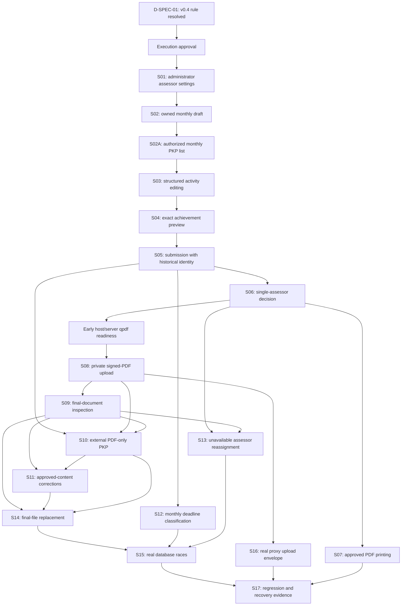

# Implementation Plan: Monthly PKP

## 1. Architectural Strategy & Task Graph

This plan follows the user's PROCEED decision and explicit request to
implement. The user approved revising v1.1 after implementation exposed an
unallocated required GET /pkp list contract. This v1.2 adds that vertical
slice without replacing the unfinished ticket checklist. Spec v0.4 resolves
D-SPEC-01 through the user's explicit option A. The SHA above identifies
the unchanged upstream Spec v0.4 input; its Draft status is not changed here.

Work in complete vertical slices: persistence, domain rules, authorization,
HTTP/Blade, and observable verification for one user capability at a time.
Do not create all tables, all services, or all pages as separate phases.
Each slice below contains bounded execution tickets; finish its demo before
starting a dependent slice. Tickets are internal increments of that same
outcome, not independently deployable unfinished feature layers.

Every execution ticket has at most five explicitly owned primary files.
Existing shared files receive surgical edits. Migration files add only
structures used by their slice, including nullable FK placeholders where
later evidence tables do not yet exist. Supporting types are scheduled
explicitly; if implementation discovery requires additional files, split
that ticket in a plan revision before coding, retain its upstream refs,
and do not silently turn it into an XL task.

No prefactoring of Izin/Cuti or global Gate removal is justified. Existing
Izin changes and dependency lockfiles are already dirty and must be
preserved. Before coding, record the checkout baseline and isolate new
work without resetting, overwriting, staging, or committing unrelated work.

Execute serially in the documented dependency order. Branches express
independence, not authorization to dispatch agents or concurrently edit
shared controllers/routes. No delegation is required by this plan.

## 2. Requirements & Constraints

- REQ-001..016: Both authoring paths, variable activities, exact scoring,
  single assessor, PDF print/upload, history, deadlines, reassignment,
  document completeness, and accessible owner/admin forms from the spec.

- SEC-001..006: Real User/Pegawai ownership; verified active accounts; private
  documents; direct PkpAuthorization; no score overrides; no global Gate-based
  assignment bypass or self-approval.

- CON-001..003: CONSTRAINTS.md remains unchanged; Laravel/Blade/UUID
  conventions; PKP does not inherit Izin's approval depth or admin bypass.

- Existing CONTEXT.md definitions remain authoritative. PKP terminology is the
  spec's proposed extension, not a redefinition of Izin roles. ADR 0001
  remains confined to the Izin update discriminator.

- Ticket-005A closes the required GET /pkp listing contract before the
  navigation/browser ticket claims the administrative all-record entry.

### Common RED-GREEN-VERIFY-COMMIT Protocol

Each ticket uses this protocol plus its explicit checklist below:

1. RED: Name its public seam and write meaningful assertions for its ACs. Run
   the focused test and capture failure for the absent/wrong behavior. First
   HTTP contracts may fail with missing-route 404 rather than the expected
   outcome. Missing vendor, broken bootstrap, missing test DB, or a new
   class's autoload error alone is not valid RED evidence. Establish a stable
   HTTP oracle before new domain types; add service oracles as the public
   types become runnable, without private reflection.

2. GREEN: Implement only that bounded behavior using real policy, database,
   services, and validation. Introduce types/migration columns needed by this
   outcome incrementally. No successful-response stubs in integration.

3. VERIFY: Run the ticket's focused suite, format checks on changed PHP, and
   relevant build/browser/runtime evidence. Each phase requires the macro gate
   below. New failures stop progression; no skip/suppression.

4. COMMIT: Stage only this ticket's verified files/lines. Preserve unrelated
   dirty content. Atomic conventional English message explains the outcome. No
   commit/push occurs merely because this plan lists a message.

New-seam bootstrap slices use the explicitly owned HTTP RED probes
below. Their intermediate packets have verification checkpoints, not
independent final GREEN/COMMIT claims. Close and commit each atomic group
only after its integration probe and all grouped tests are green. Other
tickets retain their normal independent focused GREEN/COMMIT sequence.

### Verification Command Families

- **V-PHP:** `php artisan test --filter=<ticket test class>` and
  `./vendor/bin/pint --test` for changed PHP or explicit changed paths.

- **V-WEB:** `npm run build` and `npx playwright test
  --config=playwright.pkp.config.js --project=chromium`. The dedicated harness
  uses a disposable persistent test database file, not per-request SQLite
  :memory:. Commit test fixtures before starting the real server. No
  developer-server reuse or test-only public auth shortcut.

- **V-DB:** `php artisan test --configuration=phpunit.pkp-concurrency.xml`
  once with isolated pgsql and once with isolated mysql credentials. Do not
  inherit forced SQLite defaults; wrong driver/unavailable service fails.

- **V-STACK:** Real authenticated HTTP against the provisioned Nginx, PHP-FPM
  and qpdf stack, with actual bytes, session/CSRF and private files. Configure
  the PKP harness to use that server for stack checks, not artisan serve.
  In-process Laravel results do not prove proxy limits.

- **V-PDF-READY:** In the actual PHP CLI/browser-server environment, record
  `qpdf --version` and confirm version >= 11 and an absolute executable. Host
  CI jobs install/verify qpdf before starting PHP/browser tests. Pass the same
  verified path through the private `PKP_QPDF_BINARY` configuration to the PHP
  runner and spawned browser server. Local runs without that verified binary
  must use the provisioned container or fail readiness; no ambient executable
  assumption or successful parser mock is accepted.

- **V-MACRO:** `php artisan test`, `./vendor/bin/pint --test`, existing
  Chromium suite, PKP V-WEB, `npm run build`, `composer audit`, `npm audit`.
  Include introduced V-DB for both engines and V-STACK. Registry/environment
  failures are unverified, not passing. Once real parser tests exist,
  V-PDF-READY must precede both PHP and browser runs.

- **Static analysis/coverage:** No configured PHP static analyzer or numeric
  coverage floor exists in CONSTRAINTS.md. Do not invent a threshold or claim
  an unavailable check passed.

## 3. Risks & Assumptions (Extracted from Spec)

- **A1 [Assumed / Auto-Resolved], High Risk:** One monthly record and pending
  revision; immutable attempts and official/pending bindings. Planned
  verification S02/S06/S11/S15, not existing execution evidence.

- **A2 [Assumed / Auto-Resolved], High Risk:** Real eligible User/Pegawai
  ownership and assignment, while admin configuration requires no Pegawai.
  Planned verification S01/S05/S13 with explicitly unlinked admin fixtures.

- **A3 [Assumed / Auto-Resolved], High Risk:** Exact arithmetic, bounds, null
  drafts, permissions, retention, errors and approved-only prints. Planned
  verification S03..S17; no alternative score formula or purge.

- **A4 [Assumed / Auto-Resolved], High Risk:** qpdf >= 11 and its separate
  structural/password/page-count conventions and process bounds. Verify host
  CLI and browser-server availability in Ticket-018A before parser tests, then
  final image/runtime paths in Ticket-018 and S16.

- **A5 [Assumed / Auto-Resolved], High Risk:** Direct PkpAuthorization is
  decisive despite positive global Gate results. Preserve actual provider
  behavior; test locked mutation denial in S05/S06/S09/S13 and S17.

- **Database risk:** phpunit.xml forces SQLite; production compose selects
  pgsql; Sail uses MySQL. Baseline-migrate isolated supported engines before
  races. Report inherited failures without unapproved unrelated schema fixes.

- **Request-path risk:** Production Nginx currently limits bodies to 3m. S16
  verifies the real 16 MiB envelope with the 10 MiB file rule.

- **Fixture risk:** SimpegTestCase always links Pegawai; construct the
  bootstrap admin separately and verify its relation is actually absent.

- **Browser risk:** Existing webServer uses :memory:. The PKP harness must use
  a disposable durable DB, committed fixtures and a controlled server.

- **Remaining unknowns:** Live deployment engine, actual runtime binaries,
  migrations, baseline tests and active layouts require Code-phase proof.

### D-SPEC-01: Signed External Final Replacement

Owner: tdd-spec author. Rule status: RESOLVED IN SPEC v0.4. The user chose
option A and Q20/Section 4.2/AC-063 define the rule. This planner does not
select another behavior. Approval of the whole execution baseline remains
pending and separate from resolution of that business decision.

- Application, unsigned external and originally signed external revisions may
  receive same-content signed_final replacement candidates. - Accepted A
  remains final/complete until B is inspected and accepted. Return/failure
  preserves A; archived content revisions cannot complete or accept
  replacement for a newer official revision. - Owner replacement requires
  content_unchanged=true; inspector accept requires
  matches_approved_content=true. Missing/false declarations return the exact
  spec 422 codes with preserved binding/candidate state. - Content change
  needs a new PKP revision. No automated OCR equivalence or
  signature-authenticity guarantee is introduced. - Original source, approval
  actor/score, previous file/review and first lateness event stay immutable.
  External print still streams the approved source; current accepted final is
  exposed through its separate download. - AC-039/040/061/063/078 retain their
  existing IDs with revised scopes. All 90 completion owners remain in the
  matrix with updated evidence. - This plan's baseline version/hash now
  matches v0.4. Independent re-audit and explicit execution approval are still
  required; no code is authorized.

### Execution Preconditions

- [ ] Spec v0.4 rule resolution reviewed and whole execution baseline
  approved.

- [ ] Plan approved after cross-artifact audit/clarification.

- [ ] Working-tree baseline preserved and coding checkout isolated as needed.

- [ ] Baseline PHPUnit/build/format status recorded before RED changes.

- [ ] Test credentials target disposable databases only.

## 4. Tracer-Bullet Implementation Slices

The slice-level demo is the acceptance boundary. Its execution tickets
below are bounded increments within that one capability. File lists
include tests and migrations; no global all-DB/all-API/all-UI sequence.
Every ticket is currently unchecked. All tickets inherit the execution
preconditions, real-implementation rules, and V-MACRO phase gates above.

### Phase 1: MVP Application Workflow

#### S01: Administrator configures assessor choices

Blocked by: execution preconditions. Deliver the full named user outcome
through the public service/HTTP/Blade boundary; demo after all its tickets,
not after a partial schema packet.

The bootstrap has one complete behavioral GREEN and one atomic save.
Ticket-001 owns the first HTTP test and kernel_ready checkpoint;
Ticket-002 owns configuration_ready; Ticket-003 closes integration.
Internal dependencies refer to these verified checkpoints, not deferred
commit/completion states. No partial kernel/schema package is deployed.

##### Ticket-001: Establish the S01 behavioral bootstrap oracle

- **Blocked by:** Execution approval; S01 is one atomic bootstrap group.

- **Target Seam:** GET /pkp/assessor-settings/{target_pegawai_uuid}, plus
  PkpAuthorization.allows/authorize.

- **Upstream Ref:** Spec 4.1/4.2; AC-029/082 partial evidence, S01; P-002
  remediation.

- **Size/Risk:** M / High; 5 primary files.

- **File Impact:**

  - `app/Policies/PkpPolicy.php`

  - `app/Services/PkpAuthorization.php`

  - `app/Support/PkpContext.php`

  - `tests/Unit/Policies/PkpAuthorizationTest.php`

  - `tests/Feature/PkpAssessorSettingsTest.php`

- [ ] **RED:** First write
  test_bootstrap_empty_assessor_settings_http_contract in
  PkpAssessorSettingsTest. Use existing real User/Role/Permission/Pegawai
  factories: verified active admin, explicit pkp.manage-assessors, no acting
  Pegawai link, existing target Pegawai. GET with Accept application/json must
  be 200, version 0, null configured default and empty allowed set. Assert
  status before new-table queries or new-type construction. Record real
  missing-route 404 as the initial behavioral failure; bootstrap/vendor/DB
  errors do not qualify. Then add real provider/direct predicate assertions.

- [x] **GREEN:** Create direct policy/context/authorization after the valid
  HTTP RED. This packet reaches kernel_ready only when its callable policy
  tests pass; the owned HTTP probe deliberately remains RED until Ticket-003
  wires the complete real route. Do not label that remaining RED as passed or
  add a response stub.

- [ ] **VERIFY:** Run php artisan test --filter=PkpAuthorizationTest for
  kernel assertions and re-run the named bootstrap HTTP test to retain active
  RED evidence. kernel_ready enables Ticket-002 within S01; it is not final
  ticket/slice completion.

- [ ] **COMMIT:** DEFERRED: participate in the single S01 atomic commit after
  Ticket-003 makes the owned HTTP probe and all S01 tests green. Do not create
  an independent partial commit or claim final GREEN here.

##### Ticket-002: Persist administrator assessor choices

- **Blocked by:** Ticket-001 kernel_ready checkpoint, not its deferred final
  commit; execution approval.

- **Target Seam:** PkpAssessorSettingsService.configure and real configuration
  storage.

- **Upstream Ref:** Spec 4.1/4.2/4.4; AC-029/085 partial evidence; S01; P-002.

- **Size/Risk:** M / High; 5 primary files.

- **File Impact:**

  - `database/migrations/2026_10_06_100001_create_pkp_assessor_settings.php`

  - `app/Services/PkpAssessorSettingsService.php`

  - `app/Http/Requests/ConfigurePkpAssessorsRequest.php`

  - `app/Support/ConfigurationResult.php`

  - `tests/Feature/PkpAssessorSettingsTest.php`

- [ ] **RED:** Keep Ticket-001 HTTP RED active. Add
  test_assessor_settings_public_service_contract and
  test_assessor_settings_rejects_invalid_default for real database
  persistence, direct permissions, version 0-to-1, stale zero,
  self/ineligible/duplicate selections and audited values. Autoload failure is
  not substituted for the existing valid public HTTP RED.

- [x] **GREEN:** Implement only the required
  settings/allowed-set/configuration-event migration and real
  service/request/result contract. configuration_ready requires real service
  assertions to pass; the first HTTP probe remains blocked on the adapter in
  Ticket-003. No mocked ORM or fabricated successful response.

- [ ] **VERIFY:** Run focused service-contract methods in
  PkpAssessorSettingsTest, real persistence assertions and changed-PHP
  formatting. Record checkpoint configuration_ready, not complete S01/HTTP
  GREEN. Re-run initial HTTP probe without suppressing its expected pending
  failure.

- [ ] **COMMIT:** DEFERRED: all owned changes belong to the single S01 atomic
  commit after Ticket-003 completes integration. No independent commit of an
  incomplete route or test snapshot.

##### Ticket-003: Complete the administrative bootstrap HTTP slice

- **Blocked by:** Ticket-002 configuration_ready checkpoint; kernel_ready from
  Ticket-001; execution approval.

- **Target Seam:** GET/PUT /pkp/assessor-settings/{pegawai_uuid} and its Blade
  form.

- **Upstream Ref:** Spec 4.1/4.2; AC-029/082 administrative evidence; S01;
  P-002.

- **Size/Risk:** M / High; 5 primary files.

- **File Impact:**

  - `app/Http/Controllers/PkpController.php`

  - `routes/web.php`

  - `resources/views/pkp/assessor-settings.blade.php`

  - `database/seeders/UserRolePermissionSeeder.php`

  - `tests/Feature/PkpAssessorSettingsTest.php`

- [ ] **RED:** Re-run the unchanged initially failing GET probe. Add HTTP
  POST/PUT/read cases for unlinked admin, direct permission denial,
  default-set persistence, stale config and ordinary-owner foreign
  configuration denial. Template/missing-symbol errors are infrastructure
  failures, not the initial RED.

- [x] **GREEN:** Wire the actual controller/route/form to the real service and
  direct policy. Seed actual configuration permissions only. The GET
  empty-state oracle becomes 200/version 0 without a hard-coded success;
  configured values are read from real rows. Complete the S01 owner-observable
  configuration outcome.

- [ ] **VERIFY:** Run PkpAuthorizationTest and the entire
  PkpAssessorSettingsTest, relevant HTML rendering, formatter and Phase 1
  baseline gates. All S01 tests including the exact initial HTTP oracle must
  now pass before closing Tickets-001..003.

- [ ] **COMMIT:** One atomic S01 commit contains the verified union of
  Tickets-001..003. Suggested message: feat(pkp): expose guarded assessor
  configuration. Packet sizes remain bounded development scopes; they are not
  three independently committed incomplete features. The committed tree itself
  must be green, not merely a working tree with unstaged dependencies.

- [ ] **DEMO S01:** Show the complete named capability with actual
  persistence, authorized actors, and readable UI; retain observable evidence.

#### S02: Pegawai creates an owned monthly draft

Blocked by: S01. Deliver the full named user outcome through the public
service/HTTP/Blade boundary; demo after all its tickets, not after a partial
schema packet.

##### Ticket-004: Create owned monthly drafts

- **Blocked by:** Ticket-003; all tickets also require execution approval.

- **Target Seam:** PkpSubmissionService.create and POST /pkp.

- **Upstream Ref:** Spec Sections 4..7; S02; Section 4.1 capability rules; AC
  ownership in Section 4.1 matrix below.

- **Size/Risk:** M / High; 5 primary files.

- **File Impact:**

  - `database/migrations/2026_10_06_100002_create_pkp_drafts.php`

  - `app/Models/Pkp.php`

  - `app/Services/PkpSubmissionService.php`

  - `app/Http/Requests/StorePkpRequest.php`

  - `tests/Feature/PkpDraftTest.php`

- [ ] **RED:** Before new production types, own
  test_bootstrap_owned_draft_http_contract in the listed PkpDraftTest file:
  POST /pkp as a real linked eligible owner expects 201 with owned
  period/draft; use only existing User/Pegawai fixtures before the request and
  assert status before new-table queries. Record the actual missing endpoint
  or missing required behavior assertion, not autoload/bootstrap/DB failure,
  as the slice RED. Then add its public service cases. Create one owned
  year/month, reject duplicate with existing-record conflict, reject unlinked
  personal creator, allow future draft, and inspect real FK ownership/version.

- [x] **GREEN:** Add only PKP/revision rows, period sentinel and nullable
  official/pending bindings needed for draft creation. Derive owner from
  User.pegawai; do not trust supplied owner fields.

- [ ] **VERIFY:** Run real draft-creation service-contract cases in
  PkpDraftTest and changed PHP formatting. draft_storage_ready enables
  Ticket-005; retain the initial POST HTTP RED until the actual adapter is
  wired. S02 final closure/commit waits for Ticket-006 navigation/harness
  evidence.

- [ ] **COMMIT:** DEFERRED: draft_storage_ready is an internal S02 checkpoint.
  Final GREEN/COMMIT belongs to Ticket-005, which must close the unchanged
  owned HTTP probe and all grouped service/route/UI evidence in one atomic
  verified slice commit. No independent incomplete snapshot.

##### Ticket-005: Offer the owner draft form

- **Blocked by:** Ticket-004 draft_storage_ready; execution approval.

- **Target Seam:** GET /pkp/create, /pkp/my-assessor-options and own
  detail/edit reads.

- **Upstream Ref:** Spec Sections 4..7; S02; Section 4.1 capability rules; AC
  ownership in Section 4.1 matrix below.

- **Size/Risk:** M / High; 5 primary files.

- **File Impact:**

  - `app/Services/PkpAssessorOptionsService.php`

  - `app/Http/Controllers/PkpController.php`

  - `routes/web.php`

  - `resources/views/pkp/create.blade.php`

  - `tests/Feature/PkpDraftTest.php`

- [ ] **RED:** Read only own eligible alternatives/default, render form with
  current local period and CSRF, preserve draft when settings unset, and
  reject foreign nested UUID.

- [x] **GREEN:** Wire owner create/read/edit contracts through real
  service. Render initial detail/edit using the shared PKP form component;
  create later dedicated files only in their allocated ticket. Keep zero
  versions exclusive to config.

- [ ] **VERIFY:** Run focused PkpDraftTest through V-PHP; capture
  commands/outcomes and parent demo evidence. Formatter and applicable
  macro/engine gates are mandatory as defined in Section 2.

- [ ] **COMMIT:** DEFERRED: draft_http_ready requires original create HTTP
  probe and all draft/options/detail/edit-form tests green, but S02 closes at
  Ticket-006 after actual navigation/harness checks. One S02 atomic commit
  prevents a detached unusable UI entry snapshot.

##### Ticket-005A: Authorize and query monthly PKP lists

- **Blocked by:** Ticket-005 draft_http_ready; execution approval.

- **Target Seam:** `PkpAuthorization.viewOwnList/viewAll` and the real list
  query behind GET /pkp.

- **Upstream Ref:** Spec Sections 4.1, 4.2, and 5; S02A; AC-082 partial
  evidence.

- **Size/Risk:** M / High; 5 primary files.

- **File Impact:**

  - `app/Policies/PkpPolicy.php`

  - `app/Services/PkpAuthorization.php`

  - `app/Services/PkpSubmissionService.php`

  - `tests/Feature/PkpDraftTest.php`

- [ ] **RED:** First write the owner and unlinked-admin GET /pkp contract
  cases in PkpDraftTest and record the real missing-route RED. Add public
  authorization/query assertions for eligible owner-only scope, view-all
  role-plus-permission requirements, owner isolation, `year`/`page` bounds,
  25-row pagination, stable descending year/month/UUID ordering, revision
  references and content/document completeness. Keep the owned HTTP RED
  active while the route remains unwired.

- [x] **GREEN:** Add the explicit `viewOwnList` predicate/action to the
  authoritative module authorization boundary and implement persisted list
  retrieval in PkpSubmissionService. Derive own scope from the actor's linked
  Pegawai; derive all scope only after direct view-all authorization. Do not
  add month placeholders: an empty result is distinct from an existing row
  whose content or signed document is incomplete.

- [ ] **VERIFY:** Run the service/policy list assertions and focused
  authorization tests through V-PHP. Verify pagination, ordering, ownership,
  status derivation and that the original GET /pkp test still fails only
  because the public route is pending Ticket-005B. Run changed-PHP format.

- [ ] **COMMIT:** DEFERRED: this is a readiness packet in the atomic S02A
  group. Do not commit the unfinished public route/list slice independently.

##### Ticket-005B: Render the monthly PKP list

- **Blocked by:** Ticket-005A list_query_ready; execution approval.

- **Target Seam:** GET /pkp JSON and Blade list, default own scope and
  authorized `scope=all`.

- **Upstream Ref:** Spec Sections 4.1, 4.2, and 5; S02A; AC-082 partial
  evidence.

- **Size/Risk:** M / High; 4 primary files.

- **File Impact:**

  - `app/Http/Controllers/PkpController.php`

  - `routes/web.php`

  - `resources/views/pkp/index.blade.php`

  - `tests/Feature/PkpDraftTest.php`

- [ ] **RED:** Re-run the unchanged Ticket-005A HTTP RED. Assert JSON and
  rendered HTML include the selected year, own/all scope, official/pending
  references, approval and document completeness. Assert invalid years/pages
  return 422, an unauthorized all scope returns 403, and an empty list is
  clearly distinct from an existing incomplete PKP.

- [x] **GREEN:** Wire the real route, controller and Blade view to the
  authorized PkpSubmissionService query. Return at most 25 ordered rows per
  page, enforce the year filter and scope policy, and render explicit empty,
  incomplete and approved/completeness states without exposing private paths.

- [ ] **VERIFY:** Run the exact GET /pkp contract cases and complete
  PkpDraftTest through V-PHP. Verify JSON and HTML, owner/admin access,
  pagination boundaries, ordering and no private data leakage. Run changed-
  PHP formatting and retain the proof for Ticket-006 browser navigation.

- [ ] **COMMIT:** DEFERRED: Ticket-006 commits the verified S02/S02A user
  entry and listing outcome atomically after desktop/mobile browser checks.
  Do not create an intermediate commit of shared controller/routes.

- [ ] **DEMO S02A:** Show an owner's own monthly list and an authorized
  unlinked administrator's all-record view, including empty and incomplete
  states.

##### Ticket-006: Expose PKP navigation

- **Blocked by:** Ticket-005B list_http_ready; complete S02/S02A and their atomic
  commit here; execution approval.

- **Target Seam:** Desktop/mobile owner and administrative browser entry.

- **Upstream Ref:** Spec Sections 4..7; S02; Section 4.1 capability rules; AC
  ownership in Section 4.1 matrix below.

- **Size/Risk:** M / High; 5 primary files.

- **File Impact:**

  - `resources/views/layouts/navigation.blade.php`

  - `playwright.pkp.config.js`

  - `database/seeders/PkpE2eFixtureSeeder.php`

  - `e2e/pkp.spec.js`

  - `tests/Feature/PkpNavigationTest.php`

- [ ] **RED:** Ordinary user sees PKP entry outside existing restricted group;
  unlinked admin enters all-record/config scope. Browser uses committed test
  fixtures, not an empty per-request memory DB.

- [x] **GREEN:** Use real capability booleans and a dedicated durable isolated
  PKP browser harness. Seed only in guarded testing environment; do not create
  public fixture/clock/auth bypasses.

- [ ] **VERIFY:** Run focused PkpNavigationTest through V-PHP + V-WEB; capture
  commands/outcomes and parent demo evidence. Formatter and applicable
  macro/engine gates are mandatory as defined in Section 2.

- [ ] **COMMIT:** After original draft and list HTTP oracles, entire
  PkpDraftTest, PkpNavigationTest and desktop/mobile browser entry pass,
  commit the verified S02/S02A union atomically:
  `feat(pkp): expose monthly PKP drafts and lists`. No independent
  intermediate model-only commit is represented as complete.

- [ ] **DEMO S02:** Show the complete named capability with actual
  persistence, authorized actors, and readable UI; retain observable evidence.

#### S03: Pegawai edits structured activities

Blocked by: S02. Deliver the full named user outcome through the public
service/HTTP/Blade boundary; demo after all its tickets, not after a partial
schema packet.

##### Ticket-007: Persist editable activity groups

- **Blocked by:** Ticket-005; all tickets also require execution approval.

- **Target Seam:** PUT /pkp/{uuid}/revisions/{revision}.

- **Upstream Ref:** Spec Sections 4..7; S03; Section 4.1 capability rules; AC
  ownership in Section 4.1 matrix below.

- **Size/Risk:** M / High; 5 primary files.

- **File Impact:**

  - `database/migrations/2026_10_06_100003_create_pkp_activities.php`

  - `app/Services/PkpSubmissionService.php`

  - `app/Http/Requests/SavePkpRequest.php`

  - `tests/Feature/PkpActivityTest.php`

  - `resources/views/pkp/edit.blade.php`

- [ ] **RED:** Before new production types, own
  test_bootstrap_activity_edit_http_contract in the listed PkpActivityTest
  file: PUT the existing owned pending revision with valid ordered activity
  tree expects 200 and persisted order; assert HTTP response before
  constructing new activity types. Record the actual missing endpoint or
  missing required behavior assertion, not autoload/bootstrap/DB failure, as
  the slice RED. Then add its public service cases. Save/reorder variable
  indicator/activity trees; null incomplete fields persist; shared unit
  required; over-scale, negative/exponent values, unknown keys and bound
  violations reject without partial save.

- [x] **GREEN:** Add indicator/activity rows with draft nullability. Use
  atomic tree replacement, real Form Request bounds and server-only computed
  fields. No fixed employee/example activities.

- [ ] **VERIFY:** Run real activity-tree save service cases in PkpActivityTest
  and formatter; activity_store_ready enables Ticket-008. Keep the owned PUT
  HTTP probe active until route/controller/UI integration, not marked passed.

- [ ] **COMMIT:** DEFERRED: activity_store_ready is an internal S03
  checkpoint. Final GREEN/COMMIT belongs to Ticket-008, which must close the
  unchanged owned HTTP probe and all grouped service/route/UI evidence in one
  atomic verified slice commit. No independent incomplete snapshot.

##### Ticket-008: Edit the full tree from Blade

- **Blocked by:** Ticket-007 activity_store_ready and completed S02; execution
  approval.

- **Target Seam:** Blade JSON activity editor.

- **Upstream Ref:** Spec Sections 4..7; S03; Section 4.1 capability rules; AC
  ownership in Section 4.1 matrix below.

- **Size/Risk:** M / High; 5 primary files.

- **File Impact:**

  - `app/Http/Controllers/PkpController.php`

  - `resources/views/pkp/edit.blade.php`

  - `routes/web.php`

  - `tests/Feature/PkpActivityTest.php`

  - `e2e/pkp.spec.js`

- [ ] **RED:** Create multiple groups, edit/delete/reorder them, surface field
  errors, and save all 500 allowed activities without flattened-form
  truncation.

- [x] **GREEN:** Reuse Alpine/axios to send decimal strings and JSON tree plus
  expected version/CSRF. Wire the real PUT route and editor in the owned
  edit.blade.php; no additional unallocated partial file is needed. Keep file
  upload separate and preserve current state on conflicts.

- [ ] **VERIFY:** Run focused PkpActivityTest through V-PHP + V-WEB; capture
  commands/outcomes and parent demo evidence. Formatter and applicable
  macro/engine gates are mandatory as defined in Section 2.

- [ ] **COMMIT:** After test_bootstrap_activity_edit_http_contract and all S03
  public service/HTTP/Blade tests pass, close the grouped packet checkpoints
  and commit the verified slice union atomically. The committed tree must
  include all required adapters/types/migrations. Suggested message:
  feat(pkp): complete s03 workflow.

- [ ] **DEMO S03:** Show the complete named capability with actual
  persistence, authorized actors, and readable UI; retain observable evidence.

#### S04: Pegawai reads exact achievement values

Blocked by: S03. Deliver the full named user outcome through the public
service/HTTP/Blade boundary; demo after all its tickets, not after a partial
schema packet.

##### Ticket-009: Specify exact calculation values

- **Blocked by:** Ticket-007; all tickets also require execution approval.

- **Target Seam:** IndicatorInput, ActivityInput, ExactValue and score detail
  output.

- **Upstream Ref:** Spec Sections 4..7; S04; Section 4.1 capability rules; AC
  ownership in Section 4.1 matrix below.

- **Size/Risk:** M / High; 5 primary files.

- **File Impact:**

  - `app/Support/IndicatorInput.php`

  - `app/Support/ActivityInput.php`

  - `app/Support/ExactValue.php`

  - `tests/Feature/PkpScoreDisplayTest.php`

  - `tests/Unit/PkpCalculationContractTest.php`

- [ ] **RED:** Own test_bootstrap_exact_score_detail_http_contract in
  PkpScoreDisplayTest. Use a real complete draft created/edited by finished
  S02/S03 with target 3 and realization 2. GET its existing authorized detail
  page expects 200 and visible 66,666666... plus 200/3 details. Record missing
  expected score text as valid behavioral RED, without constructing absent
  DTOs first. Then add public input/ExactValue field and immutability
  assertions; CalculationResult assertions belong to Ticket-010.

- [x] **GREEN:** Introduce the three input/exact-value contracts only after
  the valid existing HTTP assertion fails. value_contract_ready requires their
  own assertions to pass; score HTTP probe stays active RED until Ticket-011.
  No public class-existence check qualifies as behavior proof.

- [ ] **VERIFY:** Run input/ExactValue cases in PkpCalculationContractTest and
  retain the named score-detail HTTP RED. value_contract_ready enables
  Ticket-010 within atomic S04; no final slice GREEN is claimed.

- [ ] **COMMIT:** DEFERRED: S04 is committed once at Ticket-011 after its
  original real score-detail oracle, typed contracts, calculator and UI
  evidence all pass. No incomplete DTO-only commit snapshot.

##### Ticket-010: Calculate bounded exact scores

- **Blocked by:** Ticket-009 value_contract_ready; execution approval.

- **Target Seam:** PkpCalculator.calculate.

- **Upstream Ref:** Spec Sections 4..7; S04; Section 4.1 capability rules; AC
  ownership in Section 4.1 matrix below.

- **Size/Risk:** M / High; 5 primary files.

- **File Impact:**

  - `app/Services/PkpCalculator.php`

  - `app/Support/CalculationResult.php`

  - `tests/Unit/PkpCalculatorTest.php`

  - `composer.json`

  - `composer.lock`

- [ ] **RED:** Assert independent examples: 6/5 realization caps to 100, mean
  of capped 100 and 60 is 80, unequal indicator group sizes yield overall 90,
  credit 0.02 times 6 is 0.12, and raw 90.991 predicate differs from 90.99.

- [x] **GREEN:** Use explicitly required brick/math exact rationals, all
  activities, equally weighted indicators and normalized snapshot values.
  Never round to fit a database column or weaken current lockfile changes.

- [ ] **VERIFY:** Run PkpCalculatorTest and the CalculationResult cases after
  this owned type is callable. Use independent exact expected values, no
  missing-class RED substitution. calculator_ready enables Ticket-011 while
  the HTTP score oracle remains unfulfilled.

- [ ] **COMMIT:** DEFERRED: join the atomic verified S04 commit at Ticket-011.
  Its Composer requirement/lock changes must be included together with any
  directly importing calculator/value code; never commit a
  dependency-incomplete snapshot.

##### Ticket-011: Preview exact performance values

- **Blocked by:** Ticket-010 calculator_ready, Ticket-008; all tickets also
  require execution approval.

- **Target Seam:** Owner score detail and calculator display.

- **Upstream Ref:** Spec Sections 4..7; S04; Section 4.1 capability rules; AC
  ownership in Section 4.1 matrix below.

- **Size/Risk:** M / High; 5 primary files.

- **File Impact:**

  - `app/Http/Controllers/PkpController.php`

  - `resources/views/pkp/partials/scores.blade.php`

  - `tests/Feature/PkpScoreDisplayTest.php`

  - `tests/Unit/PkpCalculatorTest.php`

  - `e2e/pkp.spec.js`

- [ ] **RED:** Display 200/3 as 66,666666... with fraction detail, exact
  terminating 90,991, and no complete overall result for an incomplete draft.
  Score override requests reject even from assessors.

- [x] **GREEN:** Render authorized server calculation values and deterministic
  decimal display; no preview-driven classification or arbitrary client score
  fields.

- [ ] **VERIFY:** Run focused PkpScoreDisplayTest through V-PHP + V-WEB;
  capture commands/outcomes and parent demo evidence. Formatter and applicable
  macro/engine gates are mandatory as defined in Section 2.

- [ ] **COMMIT:** After the initial
  test_bootstrap_exact_score_detail_http_contract and complete calculation
  contract/calculator/display suites pass, close Tickets-009..011 and commit
  their verified union once: feat(pkp): expose exact monthly achievement
  preview. Macro evidence is real output, not merely DTO unit checks.

- [ ] **DEMO S04:** Show the complete named capability with actual
  persistence, authorized actors, and readable UI; retain observable evidence.

#### S05: Pegawai submits a frozen monthly attempt

Blocked by: S04. Deliver the full named user outcome through the public
service/HTTP/Blade boundary; demo after all its tickets, not after a partial
schema packet.

##### Ticket-012: Resolve period-effective identity

- **Blocked by:** Ticket-011; all tickets also require execution approval.

- **Target Seam:** PkpIdentityService snapshot resolution.

- **Upstream Ref:** Spec Sections 4..7; S05; Section 4.1 capability rules; AC
  ownership in Section 4.1 matrix below.

- **Size/Risk:** M / High; 4 primary files.

- **File Impact:**

  - `app/Services/PkpIdentityService.php`

  - `tests/Unit/Services/PkpIdentityTest.php`

  - `tests/Feature/PkpSubmissionTest.php`

  - `database/seeders/PkpE2eFixtureSeeder.php`

- [ ] **RED:** Before new production types, own
  test_bootstrap_submission_http_contract in the listed PkpSubmissionTest
  file: POST submit of a real complete draft with existing valid
  histories/assessor expects 200 and submitted state; do not query absent
  attempt columns before status. Record the actual missing endpoint or missing
  required behavior assertion, not autoload/bootstrap/DB failure, as the slice
  RED. Then add its public service cases. Use real rank/job/work-unit
  histories before/after month end; reject missing values and conflicting
  equal-date rows; no manual employee identity fallback.

- [x] **GREEN:** Select actual tmt/tanggal_mulai fields, position relation and
  satuan_kerja. Preserve source IDs/values and compare applicable snapshots
  without refreshing old approved documents.

- [ ] **VERIFY:** Run PkpIdentityTest against actual history models, preserve
  the initial submit HTTP RED in PkpSubmissionTest, and record identity_ready.
  It enables Ticket-013; do not claim whole submission class green yet.

- [ ] **COMMIT:** DEFERRED: identity_ready is an internal S05 checkpoint.
  Final GREEN/COMMIT belongs to Ticket-014, which must close the unchanged
  owned HTTP probe and all grouped service/route/UI evidence in one atomic
  verified slice commit. No independent incomplete snapshot.

##### Ticket-013: Freeze a submitted attempt

- **Blocked by:** Ticket-012 identity_ready; execution approval.

- **Target Seam:** PkpSubmissionService.submit.

- **Upstream Ref:** Spec Sections 4..7; S05; Section 4.1 capability rules; AC
  ownership in Section 4.1 matrix below.

- **Size/Risk:** M / High; 5 primary files.

- **File Impact:**

  - `database/migrations/2026_10_06_100004_create_pkp_submissions.php`

  - `app/Services/PkpSubmissionService.php`

  - `app/Http/Requests/SubmitPkpRequest.php`

  - `tests/Feature/PkpSubmissionTest.php`

  - `app/Models/Pkp.php`

- [ ] **RED:** Incomplete application or empty groups fail; valid current/past
  draft becomes immutable submitted attempt with server-calculated scores and
  identity. Failed first submission captures no lateness event.

- [x] **GREEN:** Add submissions/events and first-submission snapshot fields
  required now. Lock period/settings/PKP in spec order, revalidate membership
  and eligibility, and keep missing-deadline classification explicit.

- [ ] **VERIFY:** Run named submission public-service cases with actual clock,
  identity and immutable attempts. submitted_storage_ready enables Ticket-014;
  the owned submit HTTP test remains pending until integration. Whole class
  must pass only at final S05 closure.

- [ ] **COMMIT:** DEFERRED: join the atomic S05 commit at Ticket-014 after the
  initial HTTP submit oracle, PkpIdentityTest and entire PkpSubmissionTest
  pass. No partially runnable submission snapshot is committed.

##### Ticket-014: Submit from the owner detail page

- **Blocked by:** Ticket-013 submitted_storage_ready and completed S02;
  execution approval.

- **Target Seam:** POST /pkp/{uuid}/submit and frozen detail.

- **Upstream Ref:** Spec Sections 4..7; S05; Section 4.1 capability rules; AC
  ownership in Section 4.1 matrix below.

- **Size/Risk:** M / High; 5 primary files.

- **File Impact:**

  - `app/Http/Controllers/PkpController.php`

  - `routes/web.php`

  - `resources/views/pkp/show.blade.php`

  - `tests/Feature/PkpSubmissionTest.php`

  - `e2e/pkp.spec.js`

- [ ] **RED:** Owner submits from real page and sees frozen status; future
  submit is 422, another owner cannot act, inactive/unverified users are
  denied and a revoked option cannot submit. AC-071 is closed here only
  through actual HTTP mutation denial and unchanged-state assertions, with the
  real provider/middleware; earlier Unit predicates are partial evidence.

- [x] **GREEN:** Wire submit with validation errors and read-only submitted
  detail; no hidden route bypass or request timestamp. Preserve originally
  captured successful submit metadata.

- [ ] **VERIFY:** Run focused PkpSubmissionTest through V-PHP + V-WEB; capture
  commands/outcomes and parent demo evidence. Formatter and applicable
  macro/engine gates are mandatory as defined in Section 2.

- [ ] **COMMIT:** After test_bootstrap_submission_http_contract and all S05
  public service/HTTP/Blade tests pass, close the grouped packet checkpoints
  and commit the verified slice union atomically. The committed tree must
  include all required adapters/types/migrations. Suggested message:
  feat(pkp): complete s05 workflow.

- [ ] **DEMO S05:** Show the complete named capability with actual
  persistence, authorized actors, and readable UI; retain observable evidence.

#### S06: Pejabat Penilai decides submitted content

Blocked by: S05. Deliver the full named user outcome through the public
service/HTTP/Blade boundary; demo after all its tickets, not after a partial
schema packet.

##### Ticket-015: Decide as the assigned assessor

- **Blocked by:** Ticket-014; all tickets also require execution approval.

- **Target Seam:** PkpAssessmentService.decide.

- **Upstream Ref:** Spec Sections 4..7; S06; Section 4.1 capability rules; AC
  ownership in Section 4.1 matrix below.

- **Size/Risk:** M / High; 5 primary files.

- **File Impact:**

  - `database/migrations/2026_10_06_100005_create_pkp_content_decisions.php`

  - `app/Services/PkpAssessmentService.php`

  - `app/Http/Requests/DecidePkpRequest.php`

  - `tests/Feature/PkpAssessmentTest.php`

  - `app/Policies/PkpPolicy.php`

- [ ] **RED:** Before new production types, own
  test_bootstrap_assessment_http_contract in the listed PkpAssessmentTest
  file: POST decision by the real assigned eligible assessor for a past-month
  submitted attempt expects 200 and approval; no new decision-table query
  before response. Record the actual missing endpoint or missing required
  behavior assertion, not autoload/bootstrap/DB failure, as the slice RED.
  Then add its public service cases. Assigned assessor approves only after
  month end or returns with reason; self/unassigned/admin role alone is 403
  even with positive Gate. Double decisions cannot overwrite accepted
  evidence.

- [x] **GREEN:** Persist one decision per attempt, approved snapshot and
  official/pending switch. Return preserves earlier evidence. Recheck identity
  and eligibility inside locked transition; no manual score override.

- [ ] **VERIFY:** Run actual assessment-service cases in PkpAssessmentTest and
  formatter; assessment_storage_ready enables Ticket-016. Keep the original
  HTTP decision RED active until adapter/queue integration. S06 closes only
  after the whole class and UI evidence pass.

- [ ] **COMMIT:** DEFERRED: assessment_storage_ready is an internal S06
  checkpoint. Final GREEN/COMMIT belongs to Ticket-016, which must close the
  unchanged owned HTTP probe and all grouped service/route/UI evidence in one
  atomic verified slice commit. No independent incomplete snapshot.

##### Ticket-016: Show the assessor decision workflow

- **Blocked by:** Ticket-015 assessment_storage_ready; execution approval.

- **Target Seam:** GET /pkp/assessments and POST decision.

- **Upstream Ref:** Spec Sections 4..7; S06; Section 4.1 capability rules; AC
  ownership in Section 4.1 matrix below.

- **Size/Risk:** M / High; 5 primary files.

- **File Impact:**

  - `app/Http/Controllers/PkpController.php`

  - `routes/web.php`

  - `resources/views/pkp/assessments.blade.php`

  - `tests/Feature/PkpAssessmentTest.php`

  - `e2e/pkp.spec.js`

- [ ] **RED:** Assessor sees only assigned queue; return permits owner
  correction/resubmission, old attempt remains visible, and a mid-month
  approval attempt displays the specified conflict.

- [x] **GREEN:** Render queue and authorized actions/decision form; thin HTTP
  adapter delegates to real locked service and module-derived capabilities.

- [ ] **VERIFY:** Run focused PkpAssessmentTest through V-PHP + V-WEB; capture
  commands/outcomes and parent demo evidence. Formatter and applicable
  macro/engine gates are mandatory as defined in Section 2.

- [ ] **COMMIT:** After test_bootstrap_assessment_http_contract and all S06
  public service/HTTP/Blade tests pass, close the grouped packet checkpoints
  and commit the verified slice union atomically. The committed tree must
  include all required adapters/types/migrations. Suggested message:
  feat(pkp): complete s06 workflow.

- [ ] **DEMO S06:** Show the complete named capability with actual
  persistence, authorized actors, and readable UI; retain observable evidence.

- [ ] **VERIFY PHASE:** Run V-MACRO plus introduced V-DB/V-STACK; zero new
  failures and all relevant feature evidence recorded.

- [ ] **APPROVAL PHASE:** Obtain explicit user approval before the next phase.
  Approval of this plan alone does not imply future production deployment
  approval.

### Phase 2: Documents and External Authoring

#### S07: Pegawai prints an approved PKP

Blocked by: S06, S04. Deliver the full named user outcome through the public
service/HTTP/Blade boundary; demo after all its tickets, not after a partial
schema packet.

##### Ticket-017: Print approved application PKP

- **Blocked by:** Ticket-016, Ticket-011; all tickets also require execution
  approval.

- **Target Seam:** GET /pkp/{uuid}/revisions/{revision}/pdf.

- **Upstream Ref:** Spec Sections 4..7; S07; Section 4.1 capability rules; AC
  ownership in Section 4.1 matrix below.

- **Size/Risk:** M / High; 5 primary files.

- **File Impact:**

  - `app/Services/PkpPdfService.php`

  - `resources/views/pkp/pdf.blade.php`

  - `app/Http/Controllers/PkpController.php`

  - `tests/Feature/PkpPdfTest.php`

  - `e2e/pkp.spec.js`

- [ ] **RED:** Approved snapshot prints identity, every activity, group
  summaries, predicate and assessor block; future profile changes cannot alter
  it. Long text repeats headers on A4 landscape without clipping; draft print
  is 409.

- [x] **GREEN:** Use real DomPDF, read-only approved attempt and exact
  fraction appendix. Record actual rendered PDF inspection, not just
  HTML/template equality. No forced one-page shrink.

- [ ] **VERIFY:** Run focused PkpPdfTest through V-PHP + V-WEB + rendered PDF
  review; capture commands/outcomes and parent demo evidence. Formatter and
  applicable macro/engine gates are mandatory as defined in Section 2.

- [ ] **COMMIT:** Stage only verified ticket files/lines. Suggested message:
  feat(pkp): print approved application pkp. For verification/document-only
  packets use test(pkp) or docs(pkp) as appropriate.

- [ ] **DEMO S07:** Show the complete named capability with actual
  persistence, authorized actors, and readable UI; retain observable evidence.

#### S08: Pegawai uploads a readable private PDF

Blocked by: S06. Deliver the full named user outcome through the public
service/HTTP/Blade boundary; demo after all its tickets, not after a partial
schema packet.

##### Ticket-018A: Provision early host PDF test readiness

- **Blocked by:** Ticket-016; execution approval. This readiness packet
  completes before any real qpdf-dependent PHP/browser test.

- **Target Seam:** Host PHP test runner and dedicated browser application
  server.

- **Upstream Ref:** Spec 7 parser prerequisites; AC-088 prerequisite evidence;
  P-003.

- **Size/Risk:** M / High; 3 primary files.

- **File Impact:**

  - `.github/workflows/php-tests.yml`

  - `.github/workflows/playwright.yml`

  - `playwright.pkp.config.js`

- [ ] **RED:** Readiness evidence checks qpdf --version in the PHP runner and
  browser-server environment before tests, requires >= 11 and an absolute
  usable path. A missing binary is a failing operational prerequisite, not a
  domain RED claim. Existing CI has no owned provision/check to presume this
  is met.

- [x] **GREEN:** Install/verify qpdf in the host CI jobs before their
  PHP/parser tests or server startup. Configure the dedicated PKP browser
  server and runner with the same trusted absolute PKP_QPDF_BINARY path; use a
  verified provided container for local runs without a host binary. Do not
  assume Dockerfile availability reaches host processes.

- [ ] **VERIFY:** Run V-PDF-READY in both actual environments and baseline
  non-PDF PHP/browser checks. Confirm private configuration is honored by
  spawned server. Only after pdf_host_ready may Tickets-018B/018 and
  parser-dependent tests begin.

- [ ] **COMMIT:** Independent readiness commit after checks: chore(pkp):
  provision early parser test environments. This is not a claim the new
  validator/upload feature is green.

##### Ticket-018B: Establish immutable PDF inspection output

- **Blocked by:** Ticket-018A pdf_host_ready and Ticket-017; execution
  approval. This starts atomic S08 upload bootstrap.

- **Target Seam:** POST /pkp/{uuid}/revisions/{revision}/documents and
  App\Support\PdfInspection.

- **Upstream Ref:** Spec 4.2/4.3/7; AC-064..067 partial evidence; P-005.

- **Size/Risk:** M / High; 3 primary files.

- **File Impact:**

  - `app/Support/PdfInspection.php`

  - `tests/Unit/PkpPdfInspectionTest.php`

  - `tests/Feature/PkpDocumentUploadTest.php`

- [ ] **RED:** Own test_bootstrap_signed_final_upload_http_contract in
  PkpDocumentUploadTest. Prepare a real approved application PKP through
  existing finished services and use a real valid PDF fixture from approved
  printing. POST as eligible owner with actual aggregate version and
  signed_final file expects 201. Assert status before querying absent document
  tables or constructing new output types; record actual missing-route 404,
  not autoload/setup failure. Add public readonly result-shape/field
  assertions afterward.

- [x] **GREEN:** Allocate and implement exactly the spec-defined immutable
  PdfInspection fields and output contract only after valid HTTP RED.
  inspection_contract_ready requires meaningful typed-result tests; HTTP
  upload remains RED until Ticket-020 completes the group. Never return an
  invalid inspection object or invent parser results.

- [ ] **VERIFY:** Run PkpPdfInspectionTest, record typed contract checkpoint,
  and retain the exact active HTTP RED. This checkpoint enables Ticket-018; it
  is not final upload GREEN or a standalone completed feature.

- [ ] **COMMIT:** DEFERRED: join the single S08 atomic upload commit after
  Ticket-020 makes the initial HTTP probe, real validator and all upload tests
  green. No incomplete independent code/test snapshot is committed.

##### Ticket-018: Validate PDFs in provisioned runtimes

- **Blocked by:** Ticket-018A pdf_host_ready and Ticket-018B
  inspection_contract_ready; execution approval.

- **Target Seam:** PkpPdfValidator.inspect returning actual
  App\Support\PdfInspection.

- **Upstream Ref:** Spec 4.3/4.6/7; AC-067, AC-065/066 partial evidence;
  P-003/P-005.

- **Size/Risk:** M / High; 5 primary files.

- **File Impact:**

  - `app/Services/PkpPdfValidator.php`

  - `tests/Unit/PkpPdfValidatorTest.php`

  - `config/pkp.php`

  - `docker/common/php-fpm/Dockerfile`

  - `docker/apache/Dockerfile`

- [ ] **RED:** Keep the Ticket-018B HTTP RED active. Add actual
  valid/corrupt/empty/zero-page/password-required fixtures and truthful
  inspection result assertions. Fake only process faults/exit/timeout at
  adapter Unit seam; real parsing coverage is mandatory and a missing binary
  cannot qualify as domain RED.

- [x] **GREEN:** Implement inspection and absolute private executable config;
  provide binary in final images, not just builders. Preserve bytes/hash,
  distinct exit conventions and process bounds. parser_ready requires real
  parser/typed-result tests; upload HTTP integration remains pending for
  Tickets-019/020.

- [ ] **VERIFY:** Run V-PDF-READY and PkpPdfValidatorTest with real fixtures
  in the actual PHP/CI environment. Docker runtime verification is additional
  evidence, not a substitute for host/server proof. Keep the initial HTTP
  probe live until integration closes.

- [ ] **COMMIT:** DEFERRED: this functional validator packet joins the single
  verified S08 commit at Ticket-020. Do not independently commit a still-red
  full upload contract.

##### Ticket-019: Bind a private signed-file candidate

- **Blocked by:** Ticket-018 parser_ready checkpoint; execution approval.

- **Target Seam:** PkpDocumentService.store signed_final.

- **Upstream Ref:** Spec Sections 4..7; S08; Section 4.1 capability rules; AC
  ownership in Section 4.1 matrix below.

- **Size/Risk:** M / High; 5 primary files.

- **File Impact:**

  - `database/migrations/2026_10_06_100006_create_pkp_documents.php`

  - `app/Models/PkpDocument.php`

  - `app/Services/PkpDocumentService.php`

  - `app/Http/Requests/StorePkpDocumentRequest.php`

  - `tests/Feature/PkpDocumentUploadTest.php`

- [ ] **RED:** After approval upload a PDF up to 10 MiB as pending candidate;
  reject byte limit plus one; unauthorized/nested UUID uploads reject. Failed
  store/metadata commit preserves old file and creates no bound orphan.

- [x] **GREEN:** Stage/validate/hash then bind immutable metadata/version
  privately. No public disk fallback or instant completeness,
  source/declared-signature rule follows approved dependency closure.

- [ ] **VERIFY:** Run test_signed_final_store_public_service_contract and
  storage-fault service cases in PkpDocumentUploadTest with actual qpdf and
  DB. document_storage_ready requires those cases to pass. Re-run the initial
  HTTP upload oracle and record its still-pending RED until Ticket-020; never
  call the whole class green at this checkpoint.

- [ ] **COMMIT:** DEFERRED: document_storage_ready is an internal S08
  checkpoint, not final HTTP GREEN. Join the single atomic upload commit after
  Ticket-020 closes the original HTTP probe and the full real-parser/upload
  suite. No intermediate commit omits the later HTTP adapter.

##### Ticket-020: Upload from the approved detail page

- **Blocked by:** Ticket-019 document_storage_ready, Ticket-017; all tickets
  also require execution approval.

- **Target Seam:** Multipart document route and private download.

- **Upstream Ref:** Spec Sections 4..7; S08; Section 4.1 capability rules; AC
  ownership in Section 4.1 matrix below.

- **Size/Risk:** M / High; 5 primary files.

- **File Impact:**

  - `app/Http/Controllers/PkpController.php`

  - `routes/web.php`

  - `resources/views/pkp/partials/documents.blade.php`

  - `tests/Feature/PkpDocumentUploadTest.php`

  - `e2e/pkp.spec.js`

- [ ] **RED:** Owner selects signed PDF from approved page and sees awaiting
  inspection; authorized download uses private no-store attachment,
  foreign/missing object is refused.

- [x] **GREEN:** Wire real multipart handling with CSRF, byte-size feedback
  and capability-derived actions. Application in-process upload tests do not
  establish Nginx envelope behavior.

- [ ] **VERIFY:** Run the entire PkpDocumentUploadTest plus
  PkpPdfInspectionTest and PkpPdfValidatorTest with V-PDF-READY first, then
  V-PHP/V-WEB and real private-download assertions. The original 201 upload
  HTTP probe must now pass before final S08 GREEN/commit. Parser mocks cannot
  close it.

- [ ] **COMMIT:** Only after test_bootstrap_signed_final_upload_http_contract,
  PkpPdfInspectionTest, PkpPdfValidatorTest and the complete
  PkpDocumentUploadTest pass with actual parser/private storage, close
  Tickets-018B/018/019/020 and commit their verified union atomically.
  Suggested message: feat(pkp): upload validated private signed documents. The
  committed tree must contain every required adapter/type/migration.

- [ ] **DEMO S08:** Show the complete named capability with actual
  persistence, authorized actors, and readable UI; retain observable evidence.

#### S09: Pejabat Penilai inspects a signed final

Blocked by: S08. Deliver the full named user outcome through the public
service/HTTP/Blade boundary; demo after all its tickets, not after a partial
schema packet.

##### Ticket-021: Inspect the signed-document candidate

- **Blocked by:** Ticket-020; all tickets also require execution approval.

- **Target Seam:** PkpDocumentService.decide.

- **Upstream Ref:** Spec Sections 4..7; S09; Section 4.1 capability rules; AC
  ownership in Section 4.1 matrix below.

- **Size/Risk:** M / High; 5 primary files.

- **File Impact:**

  - `database/migrations/2026_10_06_100007_create_pkp_document_reviews.php`

  - `app/Services/PkpDocumentService.php`

  - `app/Http/Requests/InspectPkpDocumentRequest.php`

  - `tests/Feature/PkpDocumentInspectionTest.php`

  - `app/Policies/PkpPolicy.php`

- [ ] **RED:** Before new production types, own
  test_bootstrap_document_inspection_http_contract in the listed
  PkpDocumentInspectionTest file: POST accept of a real pending signed
  candidate as its assigned inspector with matches_approved_content=true
  expects 200 and final completeness. Record the actual missing endpoint or
  missing required behavior assertion, not autoload/bootstrap/DB failure, as
  the slice RED. Then add its public service cases. Assigned inspector accepts
  exact candidate or returns it with reason; content actor/scores never
  change. Already decided/replaced candidates cannot be rebound and old
  authority cannot act.

- [x] **GREEN:** Persist candidate-bound review and atomically accepted final
  reference. Document state is independent of content approval, preserving
  earlier accepted same-revision file when specified.

- [ ] **VERIFY:** Run real inspection public-service cases in
  PkpDocumentInspectionTest, including missing/false approved-content
  confirmation returning 422 without acceptance and unchanged score/actor.
  inspection_service_ready enables Ticket-022; retain the HTTP inspection RED
  until integration.

- [ ] **COMMIT:** DEFERRED: inspection_service_ready is an internal S09
  checkpoint. Final GREEN/COMMIT belongs to Ticket-022, which must close the
  unchanged owned HTTP probe and all grouped service/route/UI evidence in one
  atomic verified slice commit. No independent incomplete snapshot.

##### Ticket-022: Render document inspection status

- **Blocked by:** Ticket-021 inspection_service_ready; execution approval.

- **Target Seam:** Document queue and POST document decision.

- **Upstream Ref:** Spec Sections 4..7; S09; Section 4.1 capability rules; AC
  ownership in Section 4.1 matrix below.

- **Size/Risk:** M / High; 5 primary files.

- **File Impact:**

  - `app/Http/Controllers/PkpController.php`

  - `routes/web.php`

  - `resources/views/pkp/partials/document-review.blade.php`

  - `tests/Feature/PkpDocumentInspectionTest.php`

  - `e2e/pkp.spec.js`

- [ ] **RED:** Queue shows assigned pending files, return reason appears to
  owner, and acceptance alone produces complete status. Admin role alone still
  cannot inspect.

- [x] **GREEN:** Render review form and independent content/document state; no
  authenticated-signature claim and no gate-derived action bypass.

- [ ] **VERIFY:** Run focused PkpDocumentInspectionTest through V-PHP + V-WEB;
  capture commands/outcomes and parent demo evidence. Formatter and applicable
  macro/engine gates are mandatory as defined in Section 2.

- [ ] **COMMIT:** After test_bootstrap_document_inspection_http_contract and
  all S09 public service/HTTP/Blade tests pass, close the grouped packet
  checkpoints and commit the verified slice union atomically. The committed
  tree must include all required adapters/types/migrations. Suggested message:
  feat(pkp): complete s09 workflow.

- [ ] **DEMO S09:** Show the complete named capability with actual
  persistence, authorized actors, and readable UI; retain observable evidence.

#### S10: Pegawai submits externally prepared PKP

Blocked by: S08, S06, S09. Deliver the full named user outcome through the
public service/HTTP/Blade boundary; demo after all its tickets, not after a
partial schema packet.

##### Ticket-023: Submit an externally prepared PDF

- **Blocked by:** Ticket-020, Ticket-016, Ticket-022; all tickets also require
  execution approval.

- **Target Seam:** External create/upload/submit/decision contracts.

- **Upstream Ref:** Spec Sections 4..7; S10; Section 4.1 capability rules; AC
  ownership in Section 4.1 matrix below.

- **Size/Risk:** M / High; 5 primary files.

- **File Impact:**

  - `app/Services/PkpSubmissionService.php`

  - `app/Services/PkpAssessmentService.php`

  - `app/Http/Requests/StorePkpDocumentRequest.php`

  - `tests/Feature/PkpExternalTest.php`

  - `resources/views/pkp/create.blade.php`

- [ ] **RED:** Submit external PDF without activities or numeric score;
  missing PDF rejects; unknown activity/score fields reject. Declared signed
  source stays pending until assessor approval.

- [x] **GREEN:** Apply real source-specific validation and month-end
  identity/approval rules. Approval of declared-signed reviewed source reuses
  exact file with acceptance evidence; unsigned source awaits signed upload.

- [ ] **VERIFY:** Run focused PkpExternalTest through V-PHP; capture
  commands/outcomes and parent demo evidence. Formatter and applicable
  macro/engine gates are mandatory as defined in Section 2.

- [ ] **COMMIT:** Stage only verified ticket files/lines. Suggested message:
  feat(pkp): submit an externally prepared pdf. For verification/document-only
  packets use test(pkp) or docs(pkp) as appropriate.

##### Ticket-024: Print approved external PDF

- **Blocked by:** Ticket-023, Ticket-022; execution approval remains required.

- **Target Seam:** Approved external PDF and authorized source download.

- **Upstream Ref:** Spec Sections 4.2/4.5/5; S10 and the AC matrix.

- **Size/Risk:** M / High; 4 primary files.

- **File Impact:**

  - `app/Services/PkpPdfService.php`

  - `app/Http/Controllers/PkpController.php`

  - `tests/Feature/PkpExternalTest.php`

  - `e2e/pkp.spec.js`

- [ ] **RED:** Assert approved external print/download returns exact original
  bytes/hash and unavailable numeric score; unapproved print remains
  forbidden.

- [x] **GREEN:** Stream approved source bytes without OCR, reconstructed PDF,
  fabricated scores, or duplicate copied final storage.

- [ ] **VERIFY:** Run PkpExternalTest through V-PHP plus V-WEB and actual
  private-file hash/download assertions. Retain parent demo evidence.

- [ ] **COMMIT:** Stage only verified ticket files/lines. Suggested message:
  feat(pkp): print approved external pdf.

##### Ticket-025: Replace a returned source PDF

- **Blocked by:** Ticket-024; execution approval remains required.

- **Target Seam:** Owner source upload after assessor return.

- **Upstream Ref:** Spec Sections 4.2/4.5/5; S10 and the AC matrix.

- **Size/Risk:** M / High; 5 primary files.

- **File Impact:**

  - `app/Services/PkpDocumentService.php`

  - `app/Http/Requests/StorePkpDocumentRequest.php`

  - `resources/views/pkp/partials/documents.blade.php`

  - `tests/Feature/PkpExternalTest.php`

  - `e2e/pkp.spec.js`

- [ ] **RED:** Return an external submission then upload replacement; new file
  needs its own signed declaration and fresh review. Old hash/declaration
  cannot complete it; archive remains retrievable.

- [x] **GREEN:** Create immutable replacement metadata and rebind only the
  editable returned candidate. Approved source never mutates. Owner resubmits
  for fresh assessor review.

- [ ] **VERIFY:** Run PkpExternalTest through V-PHP plus V-WEB and actual
  private-file hash/download assertions. Retain parent demo evidence.

- [ ] **COMMIT:** Stage only verified ticket files/lines. Suggested message:
  feat(pkp): replace a returned source pdf.

- [ ] **DEMO S10:** Show the complete named capability with actual
  persistence, authorized actors, and readable UI; retain observable evidence.

- [ ] **VERIFY PHASE:** Run V-MACRO plus introduced V-DB/V-STACK; zero new
  failures and all relevant feature evidence recorded.

- [ ] **APPROVAL PHASE:** Obtain explicit user approval before the next phase.
  Approval of this plan alone does not imply future production deployment
  approval.

### Phase 3: Corrections and Administrative Controls

#### S11: Pegawai corrects approved monthly content

Blocked by: S09, S10. Deliver the full named user outcome through the public
service/HTTP/Blade boundary; demo after all its tickets, not after a partial
schema packet.

##### Ticket-026: Create an approved-content correction

- **Blocked by:** Ticket-022, Ticket-024, Ticket-025; all tickets also require
  execution approval.

- **Target Seam:** PkpSubmissionService.revise.

- **Upstream Ref:** Spec Sections 4..7; S11; Section 4.1 capability rules; AC
  ownership in Section 4.1 matrix below.

- **Size/Risk:** M / High; 4 primary files.

- **File Impact:**

  - `app/Services/PkpSubmissionService.php`

  - `app/Http/Requests/RevisePkpRequest.php`

  - `tests/Feature/PkpRevisionTest.php`

  - `app/Models/Pkp.php`

- [ ] **RED:** Before new production types, own
  test_bootstrap_content_correction_http_contract in the listed
  PkpRevisionTest file: POST revision-create from the actual current official
  approved base as owner expects 201 and a new pending revision while old
  official stays current. Record the actual missing endpoint or missing
  required behavior assertion, not autoload/bootstrap/DB failure, as the slice
  RED. Then add its public service cases. Create R2 while R1 remains
  official/complete; only one pending revision; copy only same-source editable
  inputs. Changed source starts empty; old approval/accepted file never leaks
  into draft.

- [x] **GREEN:** Allocate revision under locks and preserve first-submission
  time/classification. Approval switches official atomically and new revision
  awaits its own final file, never archived R1 evidence.

- [ ] **VERIFY:** Run real revision public-service cases and history
  invariants; correction_ready enables Ticket-027. Keep revision-create HTTP
  probe pending until actual route integration; not whole-class GREEN.

- [ ] **COMMIT:** DEFERRED: correction_ready is an internal S11 checkpoint.
  Final GREEN/COMMIT belongs to Ticket-027, which must close the unchanged
  owned HTTP probe and all grouped service/route/UI evidence in one atomic
  verified slice commit. No independent incomplete snapshot.

##### Ticket-027: Recover changed identity before approval

- **Blocked by:** Ticket-026 correction_ready and completed S05; execution
  approval.

- **Target Seam:** Refresh-identity and correction Blade workflow.

- **Upstream Ref:** Spec Sections 4..7; S11; Section 4.1 capability rules; AC
  ownership in Section 4.1 matrix below.

- **Size/Risk:** M / High; 5 primary files.

- **File Impact:**

  - `app/Services/PkpSubmissionService.php`

  - `app/Http/Controllers/PkpController.php`

  - `routes/web.php`

  - `tests/Feature/PkpRevisionTest.php`

  - `e2e/pkp.spec.js`

- [ ] **RED:** Applicable history change causes approval conflict; owner
  refresh closes old attempt, corrects/resubmits and retains prior
  payload/history. Revision detail exposes official and pending versions
  separately.

- [x] **GREEN:** Wire reason-required identity refresh and correction actions
  into existing detail components. No general withdrawal, live approved
  identity refresh or reset of original lateness.

- [ ] **VERIFY:** Run focused PkpRevisionTest through V-PHP + V-WEB; capture
  commands/outcomes and parent demo evidence. Formatter and applicable
  macro/engine gates are mandatory as defined in Section 2.

- [ ] **COMMIT:** After test_bootstrap_content_correction_http_contract and
  all S11 public service/HTTP/Blade tests pass, close the grouped packet
  checkpoints and commit the verified slice union atomically. The committed
  tree must include all required adapters/types/migrations. Suggested message:
  feat(pkp): complete s11 workflow.

- [ ] **DEMO S11:** Show the complete named capability with actual
  persistence, authorized actors, and readable UI; retain observable evidence.

#### S12: Admin defines immutable lateness boundaries

Blocked by: S05, S01. Deliver the full named user outcome through the public
service/HTTP/Blade boundary; demo after all its tickets, not after a partial
schema packet.

##### Ticket-028: Classify the first successful submission

- **Blocked by:** Ticket-014; all tickets also require execution approval.

- **Target Seam:** PkpDeadlineService.configure and locked submit.

- **Upstream Ref:** Spec Sections 4..7; S12; Section 4.1 capability rules; AC
  ownership in Section 4.1 matrix below.

- **Size/Risk:** M / High; 4 primary files.

- **File Impact:**

  - `app/Services/PkpDeadlineService.php`

  - `app/Services/PkpSubmissionService.php`

  - `app/Http/Requests/ConfigurePkpDeadlineRequest.php`

  - `tests/Feature/PkpDeadlineTest.php`

- [ ] **RED:** Before new production types, own
  test_bootstrap_deadline_configuration_http_contract in the listed
  PkpDeadlineTest file: GET an unset month deadline as verified active
  unlinked admin with actual pkp.manage-deadlines expects 200 and version
  0/unset timestamp. Record the actual missing endpoint or missing required
  behavior assertion, not autoload/bootstrap/DB failure, as the slice RED.
  Then add its public service cases. One deadline per month for all Pegawai;
  exact deadline is on time, plus one microsecond is late but accepted. No
  deadline remains unclassified permanently; later edits/resubmits/revisions
  preserve original snapshot.

- [x] **GREEN:** Use period sentinel, UTC microsecond capture and inclusive
  Asia/Makassar comparison, audited config versions and no late penalty/lock.
  Preserve successful-submit evidence through all correction paths.

- [ ] **VERIFY:** Run actual configure/submit service scenarios in
  PkpDeadlineTest and formatting, including UTC microseconds and unset
  snapshots. deadline_service_ready enables Ticket-029; keep initial
  configuration HTTP RED pending until the real admin adapter is wired.

- [ ] **COMMIT:** DEFERRED: deadline_service_ready is an internal S12
  checkpoint. Final GREEN/COMMIT belongs to Ticket-029, which must close the
  unchanged owned HTTP probe and all grouped service/route/UI evidence in one
  atomic verified slice commit. No independent incomplete snapshot.

##### Ticket-029: Manage deadlines from administrative forms

- **Blocked by:** Ticket-028 deadline_service_ready and completed S01;
  execution approval.

- **Target Seam:** GET/PUT /pkp/deadlines/{year}/{month}.

- **Upstream Ref:** Spec Sections 4..7; S12; Section 4.1 capability rules; AC
  ownership in Section 4.1 matrix below.

- **Size/Risk:** M / High; 5 primary files.

- **File Impact:**

  - `app/Http/Controllers/PkpController.php`

  - `routes/web.php`

  - `resources/views/pkp/deadline.blade.php`

  - `tests/Feature/PkpDeadlineTest.php`

  - `e2e/pkp.spec.js`

- [ ] **RED:** Unlinked admin sets/removes deadline, ordinary owner cannot
  configure, current/past submits show correct indicators, and newly
  configured deadline does not reclassify already submitted owners.

- [x] **GREEN:** Wire admin form and immutable owner lateness display in
  existing detail; reject invalid timestamps and stale config versions.

- [ ] **VERIFY:** Run focused PkpDeadlineTest through V-PHP + V-WEB; capture
  commands/outcomes and parent demo evidence. Formatter and applicable
  macro/engine gates are mandatory as defined in Section 2.

- [ ] **COMMIT:** After test_bootstrap_deadline_configuration_http_contract
  and all S12 public service/HTTP/Blade tests pass, close the grouped packet
  checkpoints and commit the verified slice union atomically. The committed
  tree must include all required adapters/types/migrations. Suggested message:
  feat(pkp): complete s12 workflow.

- [ ] **DEMO S12:** Show the complete named capability with actual
  persistence, authorized actors, and readable UI; retain observable evidence.

#### S13: Admin restores unavailable assessment authority

Blocked by: S06, S09, S01. Deliver the full named user outcome through the
public service/HTTP/Blade boundary; demo after all its tickets, not after a
partial schema packet.

##### Ticket-030: Reassign unavailable content assessors

- **Blocked by:** Ticket-016, Ticket-003; all tickets also require execution
  approval.

- **Target Seam:** PkpAssignmentService.reassignContent.

- **Upstream Ref:** Spec Sections 4..7; S13; Section 4.1 capability rules; AC
  ownership in Section 4.1 matrix below.

- **Size/Risk:** M / High; 5 primary files.

- **File Impact:**

  - `app/Services/PkpAssignmentService.php`

  - `app/Services/PkpAuthorization.php`

  - `app/Http/Requests/ReassignPkpAssessorRequest.php`

  - `tests/Feature/PkpReassignmentTest.php`

  - `app/Policies/PkpPolicy.php`

- [ ] **RED:** Before new production types, own
  test_bootstrap_content_reassignment_http_contract in the listed
  PkpReassignmentTest file: POST reassign-assessor as authorized admin for an
  unapproved submitted attempt with eligible allowed target and reason expects
  200 and authority switch. Record the actual missing endpoint or missing
  required behavior assertion, not autoload/bootstrap/DB failure, as the slice
  RED. Then add its public service cases. Admin may reassign an unapproved
  submitted/returned revision to allowed eligible non-self actor with reason;
  old authority ends and past attempt/assignment evidence stays intact.
  Approved content cannot be reassigned.

- [x] **GREEN:** Lock and record before/after assignment separately from
  immutable input; never give administrative content approval authority.

- [ ] **VERIFY:** Run real reassignContent service cases and authority/history
  assertions in PkpReassignmentTest; assignment_service_ready enables
  Ticket-031. Keep the initial HTTP reassignment oracle active pending
  Ticket-032; no whole-class GREEN yet.

- [ ] **COMMIT:** DEFERRED: assignment_service_ready is an internal S13
  checkpoint. Final GREEN/COMMIT belongs to Ticket-032, which must close the
  unchanged owned HTTP probe and all grouped service/route/UI evidence in one
  atomic verified slice commit. No independent incomplete snapshot.

##### Ticket-031: Replace an unavailable document inspector

- **Blocked by:** Ticket-030 assignment_service_ready and completed S09;
  execution approval.

- **Target Seam:** PkpAssignmentService.reassignInspector.

- **Upstream Ref:** Spec Sections 4..7; S13; Section 4.1 capability rules; AC
  ownership in Section 4.1 matrix below.

- **Size/Risk:** M / High; 5 primary files.

- **File Impact:**

  - `app/Services/PkpAssignmentService.php`

  - `app/Services/PkpAuthorization.php`

  - `app/Http/Requests/ReassignPkpInspectorRequest.php`

  - `tests/Feature/PkpReassignmentTest.php`

  - `app/Policies/PkpPolicy.php`

- [ ] **RED:** Assign allowed replacement for approved-current document
  inspection while original content approval actor/identity/scores remain
  fixed. Invalid/unavailable/self replacement rejects.

- [x] **GREEN:** Enforce inspector-only reassignment purpose, reason and
  history. Keep current content assessor and current inspector separate; no
  generic admin acceptance.

- [ ] **VERIFY:** Run real reassignInspector service cases in
  PkpReassignmentTest with current approved actor/score unchanged. Record
  inspector_service_ready, not completed S13, and retain the owned HTTP probe
  until Ticket-032 integration.

- [ ] **COMMIT:** DEFERRED: inspector_service_ready enables Ticket-032 inside
  S13. Join the atomic S13 commit only after original HTTP reassignment, both
  public service paths and complete UI/queue evidence pass.

##### Ticket-032: Expose administrative reassignment actions

- **Blocked by:** Ticket-031 inspector_service_ready; execution approval.

- **Target Seam:** POST reassign-assessor/reassign-inspector.

- **Upstream Ref:** Spec Sections 4..7; S13; Section 4.1 capability rules; AC
  ownership in Section 4.1 matrix below.

- **Size/Risk:** M / High; 4 primary files.

- **File Impact:**

  - `app/Http/Controllers/PkpController.php`

  - `routes/web.php`

  - `resources/views/pkp/partials/reassignment.blade.php`

  - `tests/Feature/PkpReassignmentTest.php`

- [ ] **RED:** Add HTTP RED assertions for both endpoints and page assertions
  proving an authorized administrator sees purposeful actions and allowed
  replacement choices. Invalid and unauthorized submissions must retain
  authority and content approval.

- [x] **GREEN:** Wire both explicit endpoints and current allowed-list
  selection with real service checks. Keep role grants and authority
  transitions separate.

- [ ] **VERIFY:** Run focused PkpReassignmentTest through V-PHP and confirm
  both endpoint contracts and rendered admin controls; retain the public HTTP
  evidence for Ticket-032B browser verification.

- [ ] **COMMIT:** DEFERRED: Ticket-032B closes browser/runtime proof and commits
  the verified S13 union atomically after service, HTTP, Blade, and E2E tests.

##### Ticket-032B: Verify reassignment in an authenticated browser

- **Blocked by:** Ticket-032 HTTP and Blade integration; execution approval.

- **Target Seam:** Desktop browser reassignment, followed by old/new assessor
  and inspector queue verification.

- **Upstream Ref:** Spec Sections 4..7; S13; AC-030/058/060; TDD verification
  gate V-WEB.

- **Size/Risk:** S / High; 3 primary files.

- **File Impact:**

  - `database/seeders/PkpE2EFixtureSeeder.php`

  - `e2e/pkp.spec.js`

- [ ] **RED:** Extend the guarded testing-only fixture with a second eligible
  allowed assessor. Add browser assertions showing the admin can reassign a
  submitted item with a reason, the old assessor loses the item, the new
  assessor gains it, and content approval attribution remains unchanged. Add
  the matching approved-document inspector path where an uploaded candidate
  is pending review.

- [x] **GREEN:** Seed the replacement only in the dedicated test database;
  exercise the real authenticated UI, CSRF, routes, database and queue. Do not
  add production fixture accounts or test-only authorization bypasses.

- [ ] **VERIFY:** Run PkpReassignmentTest, the full PKP Playwright project,
  changed-PHP formatting, and applicable macro gates. Capture actual browser
  authority and queue evidence; retain PDF runtime readiness.

- [ ] **COMMIT:** Close Ticket-032B only after all S13 service, endpoint,
  Blade and browser cases pass. Atomically commit the complete S13 outcome:
  `feat(pkp): complete reassignment workflow`.

- [ ] **DEMO S13:** Show the complete named capability with actual
  persistence, authorized actors, and readable UI; retain observable evidence.

#### S14: Pegawai safely replaces an accepted final

Blocked by: S11, S13, S10. Deliver the full named user outcome through the
public service/HTTP/Blade boundary; demo after all its tickets, not after a
partial schema packet.

##### Ticket-033: Replace accepted final files safely

- **Blocked by:** Ticket-026, Ticket-032B, Ticket-024; all tickets also require
  execution approval.

- **Target Seam:** Signed-final replacement and inspector decision.

- **Upstream Ref:** Spec Sections 4..7; S14; Section 4.1 capability rules; AC
  ownership in Section 4.1 matrix below.

- **Size/Risk:** M / High; 5 primary files.

- **File Impact:**

  - `app/Services/PkpDocumentService.php`

  - `app/Http/Requests/StorePkpDocumentRequest.php`

  - `tests/Feature/PkpFinalReplacementTest.php`

  - `resources/views/pkp/partials/documents.blade.php`

  - `e2e/pkp.spec.js`

- [ ] **RED:** Run AC-063 across application, unsigned external and originally
  signed external paths. Accepted A stays complete while B waits; return
  preserves A. Missing/false content_unchanged is 422
  content_revision_required without new binding; missing/false
  matches_approved_content is 422 content_not_confirmed with B pending.
  Changed content is returned for a new PKP revision, not accepted as a scan
  replacement.

- [x] **GREEN:** Implement Q20/v0.4 source matrix and typed owner/inspector
  declarations. Preserve original source, content actor/score, archived A and
  first lateness on B acceptance. Expose current accepted final separately
  from original external source print. No OCR equivalence or
  signature-authenticity guarantee.

- [ ] **VERIFY:** Run focused PkpFinalReplacementTest through V-PHP + V-WEB;
  capture commands/outcomes and parent demo evidence. Formatter and applicable
  macro/engine gates are mandatory as defined in Section 2.

- [ ] **COMMIT:** Stage only verified ticket files/lines. Suggested message:
  feat(pkp): replace accepted final files safely. For
  verification/document-only packets use test(pkp) or docs(pkp) as
  appropriate.

- [ ] **DEMO S14:** Show the complete named capability with actual
  persistence, authorized actors, and readable UI; retain observable evidence.

- [ ] **VERIFY PHASE:** Run V-MACRO plus introduced V-DB/V-STACK; zero new
  failures and all relevant feature evidence recorded.

- [ ] **APPROVAL PHASE:** Obtain explicit user approval before the next phase.
  Approval of this plan alone does not imply future production deployment
  approval.

### Phase 4: Resilience and Final Quality Gates

#### S15: Users receive consistent concurrent outcomes

Blocked by: S14, S12, S13. Deliver the full named user outcome through the
public service/HTTP/Blade boundary; demo after all its tickets, not after a
partial schema packet.

##### Ticket-034A: Make baseline UUID references PostgreSQL-compatible

- **Blocked by:** S14; PostgreSQL runtime RED found by Ticket-034.

- **Target Seam:** Fresh migrations for the `jabatan` self-reference and the
  `cuti_balance.pegawai_uuid` foreign key on PostgreSQL 16 and MySQL 8.

- **Upstream Ref:** Existing `database/migrations/2023_11_11_create_jabatan_table.php`;
  Ticket-034 migration bootstrap prerequisite.

- **Size/Risk:** S / High; 2 primary files.

- **File Impact:**

  - `database/migrations/2023_11_11_create_jabatan_table.php`

  - `database/migrations/2025_11_11_create_cuti_balance_table.php`

- [ ] **RED:** Run the unmodified fresh migration on PostgreSQL and retain
  the self-referential foreign-key failure, then the `varchar` to `uuid`
  mismatch in the cuti balance foreign key. MySQL fresh migration remains a
  passing compatibility guard.

- [x] **GREEN:** Create the Jabatan table and primary key first, then add its
  same nullable self-reference in a subsequent Schema::table block. Declare
  `cuti_balance.pegawai_uuid` as UUID so it matches its parent key. Preserve
  existing cascade and null behaviors; do not change deployed migration
  history or application data.

- [ ] **VERIFY:** Run `migrate:fresh` on isolated PostgreSQL 16 and MySQL 8;
  inspect both resulting foreign keys and apply the down migrations. Do not
  perform production migration or change unrelated baseline schema.

  Fresh-schema migrations passed on both engines. Down-migration verification
  remains open because the isolated database services were unavailable during
  final cleanup.

- [ ] **COMMIT:** Complete this small migration portability fix before
  Ticket-034 database race testing.

##### Ticket-034: Exercise real concurrent workflow transitions

- **Blocked by:** Ticket-033, Ticket-029, Ticket-032B, and Ticket-034A; all
  tickets also require execution approval.

- **Target Seam:** Dedicated PostgreSQL/MySQL integration suite.

- **Upstream Ref:** Spec Sections 4..7; S15; Section 4.1 capability rules; AC
  ownership in Section 4.1 matrix below.

- **Size/Risk:** M / High; 5 primary files.

- **File Impact:**

  - `phpunit.pkp-concurrency.xml`

  - `tests/Integration/Pkp/PkpWorkflowRaceTest.php`

  - `tests/Support/PkpConcurrencyHarness.php`

  - `.github/workflows/pkp-integration.yml`

  - `compose.pkp-tests.yaml`

- [ ] **RED:** Assert actual selected pgsql/mysql drivers and independent
  connections with committed fixtures; race duplicate create/revise/decision,
  deadline versus first submit and assignment versus approval. Wrong driver or
  missing DB fails, never skips.

- [x] **GREEN:** Provision isolated test DB jobs and deterministic barriers,
  no SQLite inheritance or parent-only rollback transaction. New runtime
  readiness assertions may fail on missing prerequisites; do not confuse that
  with domain RED.

- [ ] **VERIFY:** Run focused PkpWorkflowRaceTest through V-DB on both
  engines; capture commands/outcomes and parent demo evidence. Formatter and
  applicable macro/engine gates are mandatory as defined in Section 2.

- [ ] **COMMIT:** Stage only verified ticket files/lines. Suggested message:
  feat(pkp): exercise real concurrent workflow transitions. For
  verification/document-only packets use test(pkp) or docs(pkp) as
  appropriate.

##### Ticket-035A: Make PKP mutation results independently autoloadable

- **Blocked by:** Ticket-034 runtime bootstrap; execution approval.

- **Target Seam:** `App\Services\PkpMutationResult` PSR-4 autoload contract.

- **Upstream Ref:** Spec Section 4.3 service contract; Ticket-035 child-process
  race workers.

- **Size/Risk:** S / Medium; 3 primary files.

- **File Impact:**

  - `app/Services/PkpSubmissionService.php`

  - `app/Services/PkpMutationResult.php`

  - `tests/Unit/PkpMutationResultTest.php`

- [ ] **RED:** In a fresh PHP process, resolve
  `App\Services\PkpMutationResult` without first resolving
  `PkpSubmissionService`. Capture the current class-not-found failure.

- [x] **GREEN:** Move the immutable result value into its PSR-4-matching
  source file and remove the sibling declaration from PkpSubmissionService.
  Preserve its constructor and readonly field contract.

- [ ] **VERIFY:** Run the focused autoload/value-contract test and changed
  PHP formatting. Re-run one process-isolated submission/assignment worker.

- [ ] **COMMIT:** Complete independently after the focused test passes:
  `refactor(pkp): make mutation result autoloadable`.

##### Ticket-035: Enforce atomic race outcomes

- **Blocked by:** Ticket-034 and Ticket-035A; all tickets also require
  execution approval.

- **Target Seam:** Approval/assignment/document race outcomes.

- **Upstream Ref:** Spec Sections 4..7; S15; Section 4.1 capability rules; AC
  ownership in Section 4.1 matrix below.

- **Size/Risk:** M / High; 5 primary files.

- **File Impact:**

  - `app/Services/PkpSubmissionService.php`

  - `app/Services/PkpAssessmentService.php`

  - `app/Services/PkpAssignmentService.php`

  - `app/Services/PkpDocumentService.php`

  - `tests/Integration/Pkp/PkpWorkflowRaceTest.php`

- [ ] **RED:** Prove exactly one winner and specified 403/409 losers,
  unchanged accepted evidence, stable first-deadline snapshot and bounded
  rollback/retry. Test replaced-candidate and revoked-inspector pairs.

- [x] **GREEN:** If real race tests already pass, record coverage without
  inventing a defect. Otherwise apply only evidenced lock/version/authority
  correction at the existing public transition and keep before/after evidence.

- [ ] **VERIFY:** Run focused PkpWorkflowRaceTest through V-DB + V-PHP;
  capture commands/outcomes and parent demo evidence. Formatter and applicable
  macro/engine gates are mandatory as defined in Section 2.

- [ ] **COMMIT:** Stage only verified ticket files/lines. Suggested message:
  feat(pkp): enforce atomic race outcomes. For verification/document-only
  packets use test(pkp) or docs(pkp) as appropriate.

- [ ] **DEMO S15:** Show the complete named capability with actual
  persistence, authorized actors, and readable UI; retain observable evidence.

#### S16: Users upload through supported real runtimes

Blocked by: S08, S15. Deliver the full named user outcome through the public
service/HTTP/Blade boundary; demo after all its tickets, not after a partial
schema packet.

##### Ticket-036A: Provide the isolated Nginx and PHP-FPM test stack

- **Blocked by:** Ticket-034 PostgreSQL runtime setup; execution approval.

- **Target Seam:** Dedicated Compose services for PHP-FPM, Nginx, and a
  disposable migrated PKP database.

- **Upstream Ref:** Spec Section 7; S16 V-STACK; Ticket-036 HTTP boundary.

- **Size/Risk:** S / High; 2 primary files.

- **File Impact:**

  - `compose.pkp-tests.yaml`

  - `.github/workflows/pkp-integration.yml`

  - `docker/common/php-fpm/Dockerfile`

- [ ] **RED:** The dedicated workflow has database-only containers and cannot
  serve an authenticated request through the production Nginx/PHP-FPM path.
  In the first real start, PHP-FPM also exits because `pm.status_path` is
  appended under the global section.

- [x] **GREEN:** Add isolated app/web services using the real production
  Dockerfiles, fix the anchored PHP-FPM status-pool insertion, and provide
  test-only environment values, private storage, qpdf, and the disposable
  PostgreSQL service. Seed fixtures only after migrations finish.

- [ ] **VERIFY:** Start the stack, query its readiness, verify PHP-FPM and
  Nginx image versions, and tear down the services without shared persistent
  volumes. Preserve actual stack logs for Ticket-036.

  Readiness and request-envelope assertions passed. Final container stop status
  could not be confirmed after the Docker daemon became unavailable.

- [ ] **COMMIT:** Complete the reusable local/CI runtime packet before the
  ingress test implementation.

##### Ticket-036: Upload through the production request envelope

- **Blocked by:** Ticket-020, Ticket-034, and Ticket-036A; all tickets also
  require execution approval.

- **Target Seam:** Nginx/PHP/qpdf authenticated upload path.

- **Upstream Ref:** Spec Sections 4..7; S16; Section 4.1 capability rules; AC
  ownership in Section 4.1 matrix below.

- **Size/Risk:** M / High; 4 primary files.

- **File Impact:**

  - `docker/production/nginx/nginx.conf`

  - `docker/common/php-fpm/pkp.ini`

  - `docker/common/php-fpm/Dockerfile`

  - `tests/Integration/Pkp/PkpUploadEnvelopeTest.php`

- [ ] **RED:** Actual 10 MiB PDF reaches Laravel and succeeds; 10 MiB plus one
  reaches 422, request above 16 MiB may receive 413 with no metadata. Preserve
  old file. No synthetic in-process result stands in for proxy evidence.

- [x] **GREEN:** Apply scoped runtime limits/loaded PHP ini, verify final qpdf
  binary, and route the exact PKP document path directly to PHP-FPM with a
  16 MiB body limit. Keep all other application paths at 3 MiB and preserve
  Izin/Cuti file limits. Use real session/CSRF fixtures against Nginx rather
  than artisan serve.

- [ ] **VERIFY:** Run focused PkpUploadEnvelopeTest through V-STACK + V-DB;
  capture commands/outcomes and parent demo evidence. Formatter and applicable
  macro/engine gates are mandatory as defined in Section 2.

- [ ] **COMMIT:** Stage only verified ticket files/lines. Suggested message:
  feat(pkp): upload through the production request envelope. For
  verification/document-only packets use test(pkp) or docs(pkp) as
  appropriate.

##### Ticket-037: Verify final upload runtime parity

- **Blocked by:** Ticket-036, completed S08 and Ticket-018A; all tickets also
  require execution approval.

- **Target Seam:** PHP/browser jobs and declared alternative runtime.

- **Upstream Ref:** Spec Sections 4..7; S16; Section 4.1 capability rules; AC
  ownership in Section 4.1 matrix below.

- **Size/Risk:** M / High; 5 primary files.

- **File Impact:**

  - `docker/apache/php.ini`

  - `docker/apache/Dockerfile`

  - `docker/development/workspace/Dockerfile`

  - `.github/workflows/playwright.yml`

  - `.github/workflows/php-tests.yml`

- [ ] **RED:** Readiness verification proves qpdf in upload-serving runtimes
  and real upload browser jobs; failed validator is visible. Baseline jobs
  lacking the executable fail readiness rather than skip PDF tests.

- [x] **GREEN:** Verify final-image and alternate-runtime parity with the
  early host/server readiness already completed in Ticket-018A. Maintain
  limits and executable configuration for supported recipes; do not postpone
  initial CI provision here. Declare unsupported recipes only with approved
  runtime scope; no skipped parser coverage.

- [ ] **VERIFY:** Run focused PkpPdfValidatorTest through V-STACK + V-WEB +
  qpdf --version; capture commands/outcomes and parent demo evidence.
  Formatter and applicable macro/engine gates are mandatory as defined in
  Section 2.

- [ ] **COMMIT:** Stage only verified ticket files/lines. Suggested message:
  feat(pkp): verify supported upload runtimes in ci. For
  verification/document-only packets use test(pkp) or docs(pkp) as
  appropriate.

- [ ] **DEMO S16:** Show the complete named capability with actual
  persistence, authorized actors, and readable UI; retain observable evidence.

#### S17: Users retain verifiable history after failures

Blocked by: S15, S16, S07. Deliver the full named user outcome through the
public service/HTTP/Blade boundary; demo after all its tickets, not after a
partial schema packet.

##### Ticket-038: Recover failed private uploads without evidence loss

- **Blocked by:** Ticket-035, Ticket-037; all tickets also require execution
  approval.

- **Target Seam:** Public upload failure and private history download.

- **Upstream Ref:** Spec Sections 4..7; S17; Section 4.1 capability rules; AC
  ownership in Section 4.1 matrix below.

- **Size/Risk:** M / High; 4 primary files.

- **File Impact:**

  - `app/Services/PkpDocumentService.php`

  - `tests/Feature/PkpDocumentFailureTest.php`

  - `tests/Feature/PkpHistoryTest.php`

  - `tests/Integration/Pkp/PkpUploadEnvelopeTest.php`

- [ ] **RED:** Storage move/commit failures preserve accepted file; invalid
  replacement cannot create bound orphans; downloads never use public
  fallback. Referenced old decisions/files stay retained; only proven
  unreferenced failed staging can be removed.

- [x] **GREEN:** Add only evidenced compensation/retention fixes. No automated
  purge endpoint or new retention-duration policy;
  snapshot/declaration/assignment evidence must remain retrievable.

- [ ] **VERIFY:** Run focused PkpDocumentFailureTest through V-PHP + V-STACK;
  capture commands/outcomes and parent demo evidence. Formatter and applicable
  macro/engine gates are mandatory as defined in Section 2.

- [ ] **COMMIT:** Stage only verified ticket files/lines. Suggested message:
  feat(pkp): recover failed private uploads without evidence loss. For
  verification/document-only packets use test(pkp) or docs(pkp) as
  appropriate.

##### Ticket-039: Document implemented PKP boundaries

- **Blocked by:** Ticket-038; all tickets also require execution approval.

- **Target Seam:** Architecture/glossary traceability.

- **Upstream Ref:** Spec Sections 4..7; S17; Section 4.1 capability rules; AC
  ownership in Section 4.1 matrix below.

- **Size/Risk:** M / Medium; 3 primary files.

- **File Impact:**

  - `docs/ARCHITECTURE.md`

  - `CONTEXT.md`

  - `tests/Feature/PkpHistoryTest.php`

- [ ] **RED:** Documentation audit identifies missing new seams/modules/terms;
  actual history regression confirms document references describe retrievable
  approved/pending evidence. Do not create tautological tests just for prose.

- [x] **GREEN:** Update actual new public boundaries/topology and resolved
  canonical vocabulary with standards; preserve Izin definitions. This is a
  mandated documentation maintenance packet, not another product feature.

- [ ] **VERIFY:** Run focused PkpHistoryTest through Markdown lint + V-PHP;
  capture commands/outcomes and parent demo evidence. Formatter and applicable
  macro/engine gates are mandatory as defined in Section 2.

- [ ] **COMMIT:** Stage only verified ticket files/lines. Suggested message:
  docs(pkp): document implemented PKP boundaries. For
  verification/document-only packets use test(pkp) or docs(pkp) as
  appropriate.

##### Ticket-040: Verify complete PKP delivery

- **Blocked by:** Ticket-039, Ticket-017; all tickets also require execution
  approval.

- **Target Seam:** Both browser authoring journeys and all required quality
  gates.

- **Upstream Ref:** Spec Sections 4..7; S17; Section 4.1 capability rules; AC
  ownership in Section 4.1 matrix below.

- **Size/Risk:** M / Medium; 4 primary files.

- **File Impact:**

  - `e2e/pkp.spec.js`

  - `playwright.pkp.config.js`

  - `.github/workflows/pkp-integration.yml`

  - `docs/pkp-verification.md`

- [ ] **RED:** Run full real owner/admin/assessor journeys including
  signed-source reuse, replacement, correction, identity change and late
  flags. Missing journey or recovery evidence fails the completion inventory;
  already-green characterization is not fabricated RED.

- [x] **GREEN:** Close verified gaps only in approved planned scope, collect
  artifacts/results and migration recovery evidence. No source refactor or
  performance feature is introduced by this verification packet.

- [ ] **VERIFY:** Run focused PkpHistoryTest through V-MACRO + V-DB + V-STACK;
  capture commands/outcomes and parent demo evidence. Formatter and applicable
  macro/engine gates are mandatory as defined in Section 2.

- [ ] **COMMIT:** Stage only verified ticket files/lines. Suggested message:
  test(pkp): verify complete PKP delivery. For verification/document-only
  packets use test(pkp) or docs(pkp) as appropriate.

- [ ] **DEMO S17:** Show the complete named capability with actual
  persistence, authorized actors, and readable UI; retain observable evidence.

- [x] **VERIFY PHASE:** Run V-MACRO plus introduced V-DB/V-STACK; zero new
  failures and all relevant feature evidence recorded.

- [ ] **APPROVAL PHASE:** Obtain explicit user approval before the next phase.
  Approval of this plan alone does not imply future production deployment
  approval.

### 4.1 Complete AC Ownership Matrix

Execution reconciliation on 2026-10-07: realized functional evidence is
`docs/review/monthly-pkp-ac-evidence.md`, with 90 criteria and exact test
names. Original RED boxes are reopened because packet-specific original
failure artifacts are not retained; current remediation REDs are recorded
in `plan/plan-refactor-monthly-pkp-v1.0.md`. They do not retroactively prove
those original RED packets. Original VERIFY boxes are reopened until the
entire packet evidence, baseline recovery, and final approval are accepted.
GREEN implementation boxes do not mean complete runtime verification.
No tests or assertions were deleted, suppressed, or skipped.

Every AC-001..090 has exactly one primary completion owner below.
Ticket-018A provides the earlier AC-088 environment prerequisite; the
listed later owner closes final supported-runtime parity, not initial
provisioning. Ticket-018B owns PdfInspection support/HTTP RED; Ticket-018
closes AC-067 only after the whole S08 probe succeeds.
AC-071 primary completion is Ticket-014 actual HTTP mutation rejection;
Ticket-001 predicate assertions are early partial evidence only.

Additional service/HTTP/browser/race evidence may be collected in other
tickets; an earlier partial assertion does not complete a compound AC.
For example, AC-082 includes personal action denial after draft routes
exist, and AC-084 requires the complete owner form/submit journey after
navigation first appeared. The primary ticket closes the whole scenario.

Each PHP suite reserves a meaningful method with its AC ID, such as
`test_ac_001_creates_the_authenticated_pegawai_month`. The exact scenario
and expected outcome are Spec Section 5's corresponding Given/When/Then,
not an assertion derived from copying the implementation. Browser cases
are titled `AC-084 owner navigation and submission` and
`AC-090 complete activity tree persistence`. Record realized test names,
command outputs and artifacts beside this matrix during execution.
A mapping is not proof the planned test exists, passed, or proves runtime.

| Criterion | Slice | Completion owner | Evidence suite |
| --- | --- | --- | --- |
| AC-001 | S02 | Ticket-005 | DRAFT |
| AC-002 | S02 | Ticket-005 | DRAFT |
| AC-003 | S08 | Ticket-020 | UPLOAD |
| AC-004 | S03 | Ticket-007 | ACTIVITY |
| AC-005 | S05 | Ticket-014 | SUBMISSION |
| AC-006 | S05 | Ticket-014 | SUBMISSION |
| AC-007 | S06 | Ticket-016 | ASSESSMENT |
| AC-008 | S06 | Ticket-016 | ASSESSMENT |
| AC-009 | S07 | Ticket-017 | PDF |
| AC-010 | S09 | Ticket-022 | INSPECTION |
| AC-011 | S11 | Ticket-027 | REVISION |
| AC-012 | S15 | Ticket-035 | RACE |
| AC-013 | S08 | Ticket-019 | UPLOAD |
| AC-014 | S08 | Ticket-019 | UPLOAD |
| AC-015 | S02 | Ticket-005 | DRAFT |
| AC-016 | S07 | Ticket-017 | PDF |
| AC-017 | S04 | Ticket-011 | DISPLAY |
| AC-018 | S06 | Ticket-016 | ASSESSMENT |
| AC-019 | S04 | Ticket-010 | CALCULATOR |
| AC-020 | S04 | Ticket-010 | CALCULATOR |
| AC-021 | S05 | Ticket-014 | SUBMISSION |
| AC-022 | S10 | Ticket-023 | EXTERNAL |
| AC-023 | S10 | Ticket-023 | EXTERNAL |
| AC-024 | S10 | Ticket-023 | EXTERNAL |
| AC-025 | S10 | Ticket-024 | EXTERNAL |
| AC-026 | S10 | Ticket-023 | EXTERNAL |
| AC-027 | S02 | Ticket-005 | DRAFT |
| AC-028 | S05 | Ticket-014 | SUBMISSION |
| AC-029 | S01 | Ticket-003 | SETTINGS |
| AC-030 | S13 | Ticket-032B | REASSIGNMENT |
| AC-031 | S05 | Ticket-014 | SUBMISSION |
| AC-032 | S04 | Ticket-010 | CALCULATOR |
| AC-033 | S04 | Ticket-010 | CALCULATOR |
| AC-034 | S04 | Ticket-010 | CALCULATOR |
| AC-035 | S04 | Ticket-010 | CALCULATOR |
| AC-036 | S04 | Ticket-010 | CALCULATOR |
| AC-037 | S04 | Ticket-010 | CALCULATOR |
| AC-038 | S07 | Ticket-017 | PDF |
| AC-039 | S10 | Ticket-023 | EXTERNAL |
| AC-040 | S10 | Ticket-023 | EXTERNAL |
| AC-041 | S10 | Ticket-023 | EXTERNAL |
| AC-042 | S10 | Ticket-025 | EXTERNAL |
| AC-043 | S08 | Ticket-020 | UPLOAD |
| AC-044 | S11 | Ticket-026 | REVISION |
| AC-045 | S15 | Ticket-035 | RACE |
| AC-046 | S11 | Ticket-026 | REVISION |
| AC-047 | S11 | Ticket-027 | REVISION |
| AC-048 | S12 | Ticket-029 | DEADLINE |
| AC-049 | S12 | Ticket-029 | DEADLINE |
| AC-050 | S12 | Ticket-029 | DEADLINE |
| AC-051 | S12 | Ticket-029 | DEADLINE |
| AC-052 | S05 | Ticket-014 | SUBMISSION |
| AC-053 | S05 | Ticket-014 | SUBMISSION |
| AC-054 | S06 | Ticket-016 | ASSESSMENT |
| AC-055 | S05 | Ticket-014 | SUBMISSION |
| AC-056 | S05 | Ticket-012 | IDENTITY |
| AC-057 | S11 | Ticket-027 | REVISION |
| AC-058 | S13 | Ticket-032B | REASSIGNMENT |
| AC-059 | S15 | Ticket-035 | RACE |
| AC-060 | S13 | Ticket-032B | REASSIGNMENT |
| AC-061 | S09 | Ticket-022 | INSPECTION |
| AC-062 | S15 | Ticket-035 | RACE |
| AC-063 | S14 | Ticket-033 | REPLACEMENT |
| AC-064 | S08 | Ticket-019 | UPLOAD |
| AC-065 | S08 | Ticket-019 | UPLOAD |
| AC-066 | S08 | Ticket-019 | UPLOAD |
| AC-067 | S08 | Ticket-018 | VALIDATOR |
| AC-068 | S03 | Ticket-007 | ACTIVITY |
| AC-069 | S03 | Ticket-007 | ACTIVITY |
| AC-070 | S03 | Ticket-007 | ACTIVITY |
| AC-071 | S05 | Ticket-014 | SUBMISSION |
| AC-072 | S06 | Ticket-016 | ASSESSMENT |
| AC-073 | S17 | Ticket-038 | HISTORY |
| AC-074 | S07 | Ticket-017 | PDF |
| AC-075 | S07 | Ticket-017 | PDF |
| AC-076 | S07 | Ticket-017 | PDF |
| AC-077 | S11 | Ticket-026 | REVISION |
| AC-078 | S10 | Ticket-025 | EXTERNAL |
| AC-079 | S17 | Ticket-038 | HISTORY |
| AC-080 | S15 | Ticket-035 | RACE |
| AC-081 | S06 | Ticket-016 | ASSESSMENT |
| AC-082 | S17 | Ticket-040 | REGRESSION |
| AC-083 | S02 | Ticket-005 | DRAFT |
| AC-084 | S05 | Ticket-014 | BROWSER |
| AC-085 | S05 | Ticket-014 | SUBMISSION |
| AC-086 | S16 | Ticket-036 | ENVELOPE |
| AC-087 | S15 | Ticket-034 | RACE |
| AC-088 | S16 | Ticket-037 | VALIDATOR |
| AC-089 | S17 | Ticket-040 | REGRESSION |
| AC-090 | S03 | Ticket-008 | BROWSER |

#### Evidence Suite Paths

- **AUTH:** `tests/Unit/Policies/PkpAuthorizationTest.php`

- **SETTINGS:** `tests/Feature/PkpAssessorSettingsTest.php`

- **DRAFT:** `tests/Feature/PkpDraftTest.php`

- **ACTIVITY:** `tests/Feature/PkpActivityTest.php`

- **CALCULATOR:** `tests/Unit/PkpCalculatorTest.php`

- **DISPLAY:** `tests/Feature/PkpScoreDisplayTest.php`

- **IDENTITY:** `tests/Unit/Services/PkpIdentityTest.php`

- **SUBMISSION:** `tests/Feature/PkpSubmissionTest.php`

- **ASSESSMENT:** `tests/Feature/PkpAssessmentTest.php`

- **PDF:** `tests/Feature/PkpPdfTest.php`

- **VALIDATOR:** `tests/Unit/PkpPdfValidatorTest.php`

- **UPLOAD:** `tests/Feature/PkpDocumentUploadTest.php`

- **INSPECTION:** `tests/Feature/PkpDocumentInspectionTest.php`

- **EXTERNAL:** `tests/Feature/PkpExternalTest.php`

- **REVISION:** `tests/Feature/PkpRevisionTest.php`

- **DEADLINE:** `tests/Feature/PkpDeadlineTest.php`

- **REASSIGNMENT:** `tests/Feature/PkpReassignmentTest.php`

- **REPLACEMENT:** `tests/Feature/PkpFinalReplacementTest.php`

- **RACE:** `tests/Integration/Pkp/PkpWorkflowRaceTest.php`

- **ENVELOPE:** `tests/Integration/Pkp/PkpUploadEnvelopeTest.php`

- **HISTORY:** `tests/Feature/PkpHistoryTest.php`

- **REGRESSION:** `existing Cuti/Izin/auth/permission PHPUnit suites +
  e2e/pkp.spec.js`

- **BROWSER:** `e2e/pkp.spec.js`

#### Requirement Traceability

- REQ-001: S02/S11/S12 detail/list, official/pending and lateness evidence.

- REQ-002: S02..S10 both structured and external authoring paths.

- REQ-003..004: S03/S04/S05 variable activities, identity and exact values.

- REQ-005..006: S05/S06/S13 assigned single-assessor submission/decisions.

- REQ-007: S07 application printing and S10 exact external-source download.

- REQ-008..009: S08/S09/S14 independent signed-document completeness.

- REQ-010..011: S06/S11/S14/S17 immutable attempts, revisions and evidence.

- REQ-012: S05 unset classification, S12 deadlines and S15 races.

- REQ-013: S13 actual actor reassignment, S15 concurrent authority changes.

- REQ-014: S09 inspection and S14 safe replacement, separate from approval.

- REQ-015: S03..S16 input, period, identity, PDF and runtime invariants.

- REQ-016: S01/S02/S03/S06/S09/S12/S13 readable authorized forms/options.

- SEC-001..006: S01 direct guard and all public mutation/read tickets; S15
  races and S17 existing authorization regression evidence.

- CON-001..003: Each packet/phase verification, private isolated DB gates, no
  Gate removal or Izin two-stage workflow copied into PKP.

## 5. Rollback / Recovery Plan

- RBCK-001: Before implementation, record source baseline, migrations, runtime
  config and evidence checksums. Retain unrelated dirty Izin work and lockfile
  edits; never git reset/clean the shared checkout to roll back.

- RBCK-002: Pre-data local migration experiments may roll back only in the
  isolated test database. After real submissions/documents exist, do not drop
  PKP tables or remove history with blanket migrate:rollback. Rollback is
  feature access disabled plus the last compatible application artifact,
  retaining additive schema and private evidence.

- RBCK-003: Recovery tests exercise locked official/pending/final bindings
  across failed metadata commit, storage failure, resubmit and concurrent
  decisions. A failure keeps the prior usable file/reference. Cleanup targets
  only verified unbound staging, not old accepted snapshots/files.

- RBCK-004: Restore database and private storage from a consistent verified
  backup pair in a disposable rehearsal. Check document UUID/hash mappings,
  approved actors, versions and first-submission timestamps after restore.
  Record artifact checksums and proof; a written backup intention is not
  successful recovery evidence.

- RBCK-005: Runtime rollback restores prior Nginx/PHP image/config without
  widening other modules' accepted file sizes or removing their auth guards.
  Do not delete stored oversized-but-valid PKP documents on image rollback;
  preserve authorized retrieval even if new upload is temporarily disabled.

- RBCK-006: Use atomic targeted revert/forward-fix commits only for the new
  change, after review of dirty/shared lines. Do not force-push or erase
  another workstream's commits. No production deployment is authorized by the
  plan or its automated test outcomes.

## 6. Final Floor-Guard Gate

- [ ] D-SPEC-01 rule closure in v0.4 is recorded; whole execution baseline
  approved with actual artifacts.

- [ ] Approved source revision and plan hash/version are recorded.

- [ ] AC-001..090 (plus any author-added AC) have realized test names, correct
  public seams, independent expected results and recorded evidence.

- [ ] Each RED failed for expected behavior; each GREEN and focused VERIFY
  completed. Each phase macro suite passes with zero regressions.

- [ ] Existing Cuti/Izin/auth/role flows remain green with unchanged global
  Gate behavior; super-admin cannot bypass actual PKP policy.

- [ ] Bootstrap-style unlinked admin configuration is exercised without
  createUserWithRole silently producing Pegawai.

- [ ] Both real authoring paths run in Chromium with actual forms, committed
  fixtures, real app/session/CSRF and no response stubs.

- [ ] qpdf parses real PDF fixtures in every supported upload-serving
  runtime/CI path; errors and process bounds produce truthful failures.

- [ ] Real proxy/PHP stack proves 10 MiB acceptance, application rejection
  above the file limit and visible envelope rejection, retaining old files.

- [ ] PostgreSQL 16 and MySQL 8 gates pass on isolated databases with actual
  selected drivers and two independent connections/committed fixtures.

- [ ] First-submit lateness/identity/correction/reassignment race results
  match the specification's exact instants and version/authority outcomes.

- [ ] Immutable submitted attempts and archived files remain retrievable;
  correction approval cannot reuse an older revision's final document.

- [ ] Final-file replacement across all three v0.4 source paths preserves
  accepted A until inspected B is accepted; declarations and their exact 422
  errors are tested. No changed assessment is accepted as scan replacement.

- [ ] composer audit and npm audit completed without newly introduced
  high/critical vulnerabilities; no ignored exit statuses substitute for pass.

- [ ] No suppressed errors, skipped tests, weakened assertions, fabricated
  coverage thresholds, or destructive recovery operations were introduced.

- [ ] Generated documents and forms pass readable layout review at desktop and
  mobile widths; multi-page PDFs retain full content and exact details.

- [ ] Additive migrations have verified apply/recovery behavior on supported
  engines. Baseline PostgreSQL compatibility fixes are limited to Ticket-034A;
  other baseline migration changes require their own approved plan scope.

- [ ] docs/ARCHITECTURE.md matches implemented directories/public seams;
  canonical domain additions follow standards without redefining Izin.

- [ ] Final report distinguishes performed checks, failures and unavailable
  environments; no green claim is based on this plan's checkboxes alone.

### Plan v1.1 Audit Remediation Traceability

- **P-001:** Source version/hash now matches actual v0.4. D-SPEC-01 rule
  status is resolved; whole baseline/execution approval is still separate.
  Ticket-033 and maintained AC-039/040/061/063/078 scopes follow Q20. -
  **P-002:** Each first new-seam bootstrap has an exact owned HTTP RED probe
  before new-type construction. Internal readiness checkpoints do not pretend
  to be final GREEN/COMMIT. One atomic slice commit occurs only after the real
  adapter, service, types and all grouped tests pass. No committed tree
  depends on unstaged future files to appear green. - **P-003:** Ticket-018A
  precedes every parser-dependent PHP/browser case, naming host runner and
  spawned server executable/version evidence. Ticket-018 adds final-image
  parser implementation; Ticket-037 is later runtime parity verification, not
  deferred first CI provision. - **P-004:** AC-071 primary closure belongs to
  actual mutation HTTP tests in Ticket-014, with real provider/middleware and
  unchanged-state proof. Unit predicates in Ticket-001 remain useful partial
  evidence. - **P-005:** Ticket-018B explicitly owns App\Support\PdfInspection
  source, constructor/result assertions and first upload HTTP probe. The
  validator packet remains within its five-file scope, not a hidden sixth-file
  task. - **P-006:** Command families, A1..A5 assumptions and rule evidence
  are separate lists/sections. Wrapping must retain those structural entries.

The v1.2 plan contains 18 vertical slices and 48 bounded execution
packets: Ticket-001..040, Ticket-005A, Ticket-005B, Ticket-018A,
Ticket-018B, Ticket-032B, Ticket-034A, Ticket-035A, and Ticket-036A.
Stable prior ticket IDs remain unchanged. All 90 primary AC owners remain
assigned; AC-082 closes in S17 after its configuration, listing, and personal
action denial paths all exist. Ticket-005A provides the earlier all-record
list evidence. The v1.1 audit predates this addition and is not a v1.2 audit.
Projected author readiness is **94/100**: Completeness 40/40, Clarity 27/30,
Alignment 27/30. This is a self-assessment pending independent review, not a
replacement for the historical v1.1 audit score.

### Planning Artifact Verification and Handoff

This file is a planned task graph, not implemented functionality. During
planning only its Markdown structure, AC inventory and dependency graph
are checked; no PHP/browser/runtime tests are executed.

This v1.2 revision is now the active execution plan. Continue implementation
with Ticket-005A before claiming `/pkp?scope=all` navigation complete. The
v1.1 consistency audit does not cover this revision; record the new ticket
in the final implementation report and request a focused cross-artifact
review before declaring the Code phase complete. A phase transition may use
a new chat unless the user keeps an explicit session override. Offer a
memory-manager checkpoint before handoff and save it only if the user
authorizes that separate operation.
